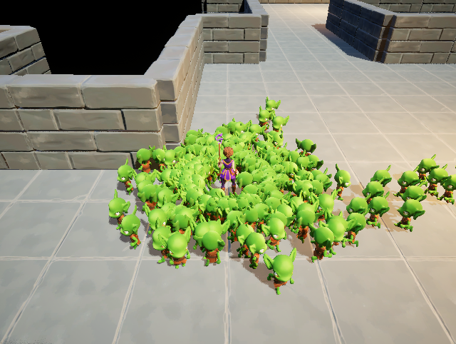
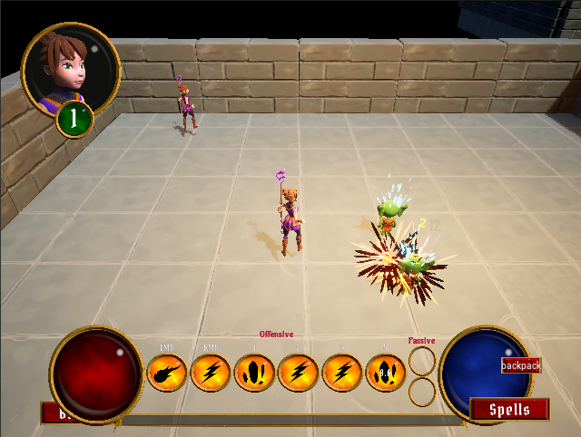

# Aura 扩展：Mass 怪物与可组合 GAS 技能

基于 Unreal Engine 5.8 的俯视角地牢 RPG。本项目从 Aura / GAS 课程工程出发，持续开发自己的玩法与工具：**纯 Mass 普通怪物、Actor / Mass 混合战斗、数据驱动的 GA 原型与组合技能、局域网组队，以及地形状态效果**。

基础角色、GAS 框架与课程素材来自原项目；下文重点展示在此基础上完成的扩展工作。

后续怪物新增与改造统一遵循 [怪物开发规范](docs/monster-development-standard.md)：复用 ASC/AI，适配对象池死亡与复用流程，并为每次攻击配置感叹号或红色实际作用范围预警。

[快速试玩](#快速试玩) · [主要功能清单](docs/project-feature-catalog.md) · [GA 制作与调用全流程](docs/ga-production-and-runtime-guide.md) · [Mass 实现](#mass-怪物与混合战斗) · [开发文档](#开发文档)



*实际 PIE 截图：迷宫配置 200 个 Goblin，画面展示其中聚集在玩家附近的一部分。玩家继续使用 Actor、GAS 与角色动画。*

## 已完成的主要工作

| 方向 | 本项目的扩展 |
|---|---|
| Mass 怪物 | 将普通怪物的数据、移动、导航、碰撞查询、战斗与骨骼实例渲染接入 Mass，不为每只怪物保留 Actor / ASC |
| 混合战斗 | 同一技能可处理 Mass 实体和 Actor 目标，服务端验证命中、结算伤害并同步表现；修复原 FireBolt 对 Mass 的命中与伤害数字 |
| GA 原型 | 18 种基础行为，新增附着、叠层、牵引 / 击退 3 种机制，通过数据资产组合技能 |
| 技能制作 | 多批原型与组合 GA、环绕火球、奥术新星；新增技能目录、中文描述、图标、学习装备及换图恢复 |
| 联机流程 | 存档后选择单人 / 多人、LAN 密码房间、房主开始后全员进入关卡、组队传送与可配置出生点 |
| 地形效果 | 岩浆灼烧、冰霜减速、毒性中毒、藤蔓缠绕，以及对应地表材质与 Niagara 表现 |
| 自动化工具 | 项目专用 `build-ga` skill、Unreal Python / MCP 资产制作流程、原生测试与双客户端 PIE 验证脚本 |

## 当前主要功能一览

以下包含沿用的基础能力与本项目扩展；详细源码入口、技能清单和适用地图见[完整功能清单](docs/project-feature-catalog.md)。

| 模块 | 已实现功能 |
|---|---|
| 角色与控制 | Actor 玩家、鼠标寻路 / WASD、目标高亮、待机 / 移动动画、施法目标指示 |
| GAS 战斗与成长 | 属性、生命 / 法力、消耗 / 冷却、抗性 / 护甲 / 格挡 / 暴击、受击 / 死亡 / 经验、等级与加点 |
| 敌人 | 既有 Actor 敌人与 AI、近战 / 远程 / 召唤技能资产，以及纯 Mass 普通怪物 |
| Mass 与混合战斗 | 实体数据、空间索引、导航 / 移动 / 碰撞、共享骨骼渲染、快照复制、Actor / Mass 技能目标、伤害数字 |
| GA 与组合 | 18 个基础行为、3 个新机制、14 个组合 GA，以及奥术新星和开关式环绕火球；另保留原有课程技能 |
| 技能管理 | 初始授予、学习 / 升级 / 装备、主动 / 被动槽、原型菜单、图标 / 描述、中文显示适配 |
| 背包与拾取 | 数据驱动物品、堆叠、交换、消耗品 GE、整组丢弃、自动 / 交互拾取、网络复制与服务端本地持久化 |
| 存档与换图 | 存档槽、角色属性与技能、检查点及可保存世界 Actor、组队换图后的技能栏恢复 |
| 模式与房间 | 单人 / 多人选择、LAN 密码创建 / 匹配、成员列表、房主全员开局、离开与错误提示 |
| 组队传送 | 全员进区持续 3 秒换图，按目标地图配置集中 / 分散出生 |
| 地形 | 岩浆灼烧、冰霜减速、毒性持续伤害、藤蔓缠绕、地表材质与特效；泥潭为视觉资源 |
| 关卡与测试 | 地牢迷宫、200 Goblin、地形测试场、技能实验场；Mass 新会话 999 技能点 |
| 工具与验证 | build-ga、MCP / Python 资产制作、原生测试、双客户端输入 / 战斗 / UI / 换图验证 |

## Mass 怪物与混合战斗

采用 **普通怪物走 Mass、玩家和特殊角色走 Actor** 的架构。普通怪物不再逐个依赖 Character、AIController、行为树或 AbilitySystemComponent；玩家继续保留现有 GAS、输入、移动与动画流程。Actor 战斗路径也可用于后续精英怪和 Boss。

- **实体数据与空间查询**：Mass Fragment 保存位置、速度、路径、生命值、攻击及状态计时，空间索引用于邻居和范围目标查询。稳定实体 ID 用于技能目标与网络同步。
- **移动、导航与碰撞**：处理器调用 Recast 寻路并缓存路径；采用数据胶囊、邻居分离、世界 Sweep、滑动和贴地处理。投射物同时考虑实体命中与世界遮挡。
- **共享骨骼渲染**：共享 `APureMassCrowd` 按怪物类型维护 `UInstancedSkinnedMeshComponent`，实体拥有各自动画轨道，支持待机、移动与攻击。
- **服务端权威与复制**：服务端管理实体战斗，共享 Actor 通过 FastArray 发送差量快照，客户端插值显示。渲染与复制使用共享 Actor，不是每只怪物创建代理 Actor。
- **统一技能目标**：`FPureMassCombatTarget` 表示 Actor 或 Mass 稳定 ID。Actor 通过 GameplayEffect 结算，Mass 通过实体战斗数据结算；范围、投射物、追踪与连锁等行为使用混合查询接口。
- **既有技能接入**：补齐原 FireBolt 的 Mass 命中适配、客户端伤害数字与玩家动画绑定，保留玩家的待机、移动和施法表现。

`L_DungeonLabyrinth` 已布置 6 个生成区域，共 **200 个 Goblin**，用于验证实体生成、移动、战斗、动画和死亡清理。这是功能测试规模，目前没有发布与 Actor 方案的同条件性能对比或更大规模性能结论。

精英概率、随机词缀和按怪物类型抽取额外 GA 的完整模式仍属于后续开发方向。

## GA 原型与组合技能

技能的生成方式、目标选择与后续效果拆分为可配置行为，由 GA 负责输入、消耗和冷却，运行时负责效果执行与目标适配。

| 类别 | 已实现行为 |
|---|---|
| 投射与传播 | Projectile、Multishot、Homing、Piercing、Chain、Returning |
| 范围与持续 | Burst、Beam、Surface、Orbit、Field、Trap |
| 形状与时序 | Cone、Wave、Emitter、Delay、Ring、Line |
| 第五批新增机制 | Attach（附着）、Stack（叠层引爆）、Displace（牵引 / 击退） |

前四批的 Mass 技能目录包含 **18 个原型和 8 个组合技能**。第五批采用独立扩展执行器和数据资产，通过 `HitChild`、`PeriodChild`、`CompleteChild` 串联命中、周期与完成事件，追加 **3 个原型、6 个组合 GA**；新测试目录合计 **35 个可选技能条目**。两套执行器各自有数据配置，并非全部节点可以直接跨执行器互换。

| 第五批组合 GA | 组合方式 |
|---|---|
| 雷霆烙印 | 附着目标 → 周期连锁雷电；目标死亡后可转移 |
| 寒霜寄生 | 附着脉冲 → 到期留下冰霜地表 |
| 三重焰印 | 火焰投射物 → 命中叠印 → 三层范围爆炸 |
| 雷链聚爆 | 连锁命中 → 各目标独立叠印 → 三层引爆 |
| 引力塌缩 | 范围牵引 → 延时 → 中心爆炸 |
| 荆棘震退 | 自身范围伤害 → 击退 → 落点生成藤蔓 |



第五批组合技能分别验证了 Actor 与 Mass 目标路径，包含服务端消耗、命中、状态、位移和客户端表现。运行时设置节点数量、深度、地表与印记预算，并处理死亡、换图和显式取消时的清理。

此外实现了 **奥术新星** 与 **环绕火球**：环绕火球作为可切换技能，开启消耗 10 MP，持续每秒消耗 1 MP，每 3 秒补充一个火球，默认上限 3 个；释放主动技能后火球依次攻击目标，参数由数据资产调整。

## GA 从制作到调用

完整操作、资产关系、调用图和源码入口见 [GA 制作与调用全流程](docs/ga-production-and-runtime-guide.md)。

1. **定义规则**：明确主动 / 开关 / 被动、目标、伤害、MP / 冷却、持续与取消、表现和联机范围。
2. **选择实现**：传统 Actor GA、前四批混合原型或第五批扩展节点；编写新逻辑时先构建并加载原生类型。
3. **制作资产**：用 build-ga 与 MCP / Unreal Python 配置子 DA、根 DA、GA、标签、GE / 表现引用；编译保存并独立读回。
4. **接入游戏**：登记正确技能目录，连接菜单学习 / 装备、角色授予、输入槽和存档；新技能默认不抢占已有槽位。
5. **输入与目标**：Enhanced Input → PlayerController → ASC 按 InputTag 找 Spec → TryActivateAbility；混合鼠标任务上传 Actor 或 Mass 实体 ID，由服务器复核。
6. **提交与执行**：服务端 Commit 一次、创建施法上下文与运行节点；命中后 Actor 走 GE / ExecCalc，Mass 走实体伤害接口，子节点不重复扣蓝。
7. **表现与收尾**：通过 Cue、复制的效果 Actor、GAS 蒙太奇或 Mass 实例状态驱动各端表现；结束、取消、死亡和换图各自清理。
8. **验收**：检查资产、核心行为、双客户端实际输入、Actor / Mass 目标、菜单、存档与换图；把报告接收和实际通过区分开。

例如已实现的三重焰印：`GA_EmberBrand → Projectile 根节点 → HitChild: Stack → 三层后 CompleteChild: Burst`。技能自身提交后结束，印记和爆炸由运行时继续管理；已完成施法的持续效果需通过专用取消接口清理。

## 联机、地形与关卡

**局域网组队**：存档选择后进入模式选择，可单人进入默认地图，或创建 / 加入 LAN 密码房间。房间展示成员与密码设置，房主开始后全员进入游戏。传送点要求所有玩家进入区域并停留 3 秒，再一起换图；目标地图可通过出生点分组和玩家槽位配置集中或分散出生。技能等级、装备栏及图标在换图后恢复。

**地形状态**：使用已有资源扩展地表材质和特效，实现岩浆灼烧、冰霜减速、毒性持续伤害与藤蔓缠绕；数据资产配置强度、持续时间与接触判定。泥潭目前提供地表视觉资源。对应测试地图为 `L_TerrainEffectsTest`。

## 快速试玩

1. 安装 **Unreal Engine 5.8** 与对应的 Windows C++ 编译工具链，克隆本仓库。
2. 为 `test_25d.uproject` 生成工程文件，编译 `test_25dEditor` 的 **Development Editor / Win64** 目标，再打开项目。项目包含源码与资产，不包含生成的二进制文件、缓存或本地工具配置。
3. 当前测试源码存在 Unity 合并编译符号冲突；本地验收使用关闭 `test_25d` 模块 Unity 的构建配置，配置方式见下方。该配置只需放在本机，不必提交。
4. 在内容浏览器选择以下地图运行 PIE。验证联机时设为 **2 Players / Play As Listen Server**。

| 地图资产路径 | 用途 |
|---|---|
| `/Game/PrototypeExtensions/Batch5/L_PrototypeLab` | 最新技能实验场：200 个 Mass Goblin、35 个技能目录条目 |
| `/Game/levels/L_DungeonLabyrinth` | 迷宫中的 200 个 Mass Goblin 功能测试 |
| `/Game/PureMass/Maps/L_PureMassDungeon` | 小规模 Mass 基础战斗测试 |
| `/Game/levels/L_TerrainEffectsTest` | 地形效果测试 |

在新技能实验场打开技能菜单，学习并装备技能后施放。Mass 模式每个玩家在新游戏会话首次进入时获得 **999 技能点**；消费、重生和换图保留剩余点数，不会因切图补满。普通模式不使用此测试初始化规则。

<details>
<summary>本地 Unity 编译兼容配置</summary>

在项目 `Saved/UnrealBuildTool/BuildConfiguration.xml` 中添加以下配置；若文件已有其他配置，将 `ModuleConfiguration` 节点合并到原 `Configuration` 内。

```xml
<?xml version="1.0" encoding="utf-8" ?>
<Configuration xmlns="https://www.unrealengine.com/BuildConfiguration">
  <ModuleConfiguration>
    <DisableUnityBuild>
      <Item>test_25d</Item>
    </DisableUnityBuild>
  </ModuleConfiguration>
</Configuration>
```

</details>

## 验证记录与当前范围

以下是 **2026-10-25 第五批验收记录**，不是远端 CI 状态：

- Editor 编译完成；原生套件 135 项通过，其中 62 项 Success、73 项 SuccessWithWarnings，0 项失败。
- 6 个新组合 GA × Actor / Mass 两种目标，共 12 个双客户端战斗用例、89 项检查。
- 三次组队换图 33 项检查；菜单学习和显示 7 项；资产读回与原文件哈希 84 项；原 Mass 关卡技能点消费同步 6 项。

详细步骤和结果见[第五批开发记录](docs/2026-10-25-ga-batch5-guide.md)。测试脚本随源码提交，运行报告位于本地 `Saved/`，不会作为项目缓存上传。当前成果面向 Windows 编辑器与局域网 PIE；尚未完成打包版本、互联网联机服务或大规模性能验收。

## 开发文档

- **总览与流程**：[主要功能清单](docs/project-feature-catalog.md) · [GA 制作与调用全流程](docs/ga-production-and-runtime-guide.md)
- **Mass**：[实现架构](docs/2026-10-23-pure-mass-guide.md) · [200 Goblin 关卡](docs/2026-10-23-labyrinth-mass-200.md) · [混合目标适配](docs/2026-10-23-mixed-mass-actor-skills.md) · [玩家动画边界](docs/2026-10-23-player-animation-and-mass-boundary.md) · [原 FireBolt 适配](docs/2026-10-23-legacy-firebolt-mass-fix.md)
- **技能**：[基础原型](docs/2026-10-22-ga-prototypes-guide.md) · [组合技能](docs/2026-10-22-ga-compositions-guide.md) · [第三批](docs/2026-10-22-ga-prototypes-batch3-guide.md) · [第四批](docs/2026-10-23-ga-prototypes-batch4-guide.md) · [第五批](docs/2026-10-25-ga-batch5-guide.md)
- **独立能力**：[奥术新星](docs/2026-10-21-arcane-nova-guide.md) · [环绕火球](docs/2026-10-21-orbiting-fire-bolt-guide.md)
- **联机与地形**：[LAN 房间](docs/2026-10-22-lan-rooms-guide.md) · [组队传送](docs/2026-10-22-party-portal-guide.md) · [换图技能栏](docs/2026-10-22-skill-bar-travel-fix.md) · [地形效果](docs/2026-10-22-terrain-effects-guide.md)
- **制作工具**：[build-ga skill](skills/build-ga/SKILL.md) · [GA 脚本](Scripts/GA) · [Mass 脚本](Scripts/PureMass)

主要源码入口：[`PureMass`](Source/test_25d/Private/PureMass)、[`Prototypes`](Source/test_25d/Private/AbilitySystem/Prototypes)、[`PrototypeExtensions`](Source/test_25d/Private/AbilitySystem/PrototypeExtensions)。

## 来源与学习记录

基础工程参考 Stephen Ulibarri 的 [GAS Top Down RPG 课程](https://www.udemy.com/course/unreal-engine-5-gas-top-down-rpg/) 与 [Aura 原仓库](https://github.com/DruidMech/GameplayAbilitySystem_Aura)，学习过程亦参考 CSDN 暮志未晚NAN、GitHub ShinyRuo 的笔记。基础课程代码与美术素材不作为本项目原创内容。

原首页的课程学习笔记完整保留在[学习记录](docs/aura-learning-notes.md)。本页展示的是在基础工程上完成的玩法、架构适配、资产制作流程和验证工作。
