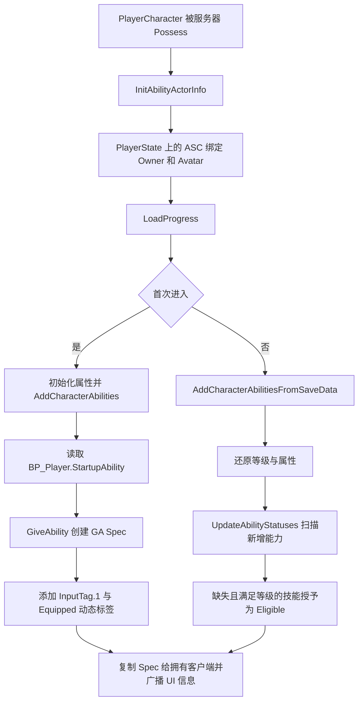
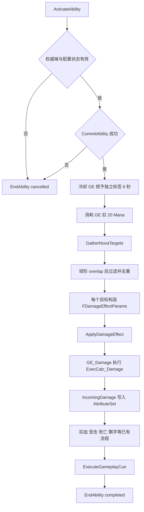

# 奥术新星 GA 设计与制作流程

本章记录 `test_25d` 项目中新能力 **Arcane Nova（奥术新星）** 的设计、C++ 实现、蓝图资产制作、输入与技能菜单接入、存档处理，以及运行时的完整调用过程。项目使用 UE 5.8.1、GAS、Enhanced Input，并沿用既有 Aura 风格的 `My*` C++ 类型和 `Content/BluePrints/AbilitySystem` 目录。

## 1 试玩入口与能力规则

**新建角色进入游戏后，按数字键 1 释放奥术新星。** 在技能菜单的奥术列中间一格，可以选择它、消耗技能点升级或重新装备到其他进攻技能槽。

已有存档载入后，新能力以 `Eligible` 状态出现；需要在技能菜单学习并装备。已保存的技能等级与输入槽不会被新能力覆盖。不要删除原存档来测试，使用空存档槽即可。

| 项目 | 实现值与行为 |
| --- | --- |
| 定位 | 被敌人包围时使用的即时范围攻击 |
| 施法中心 | 服务器上的施法者当前位置 |
| 半径 | 450 Unreal Units；按双方 Actor 中心的三维距离判断 |
| 基础伤害 | 1 级 45；每升 1 级增加 15，即 2 级 60、3 级 75 |
| 伤害类型 | `Damage.Magic`，进入项目现有魔法抗性、护甲、格挡、暴击结算 |
| 法力 | 每次成功释放消耗 20；对多个目标只扣一次 |
| 冷却 | 6 秒，独立标签 `Cooldown.Arcane.ArcaneNova` |
| 目标 | 范围内存活、敌对、实现 CombatInterface 且具有 ASC 的 Actor |
| 排除 | 施法者、友军、死亡目标、范围外目标、没有 ASC 的物体 |
| 释放条件 | 不能死亡、眩晕、受击或带有 `Player.Block.InputHeld`，且资源与配置有效 |
| 空放 | 允许；照常消耗法力并进入冷却 |
| 附加效果 | 不添加 Debuff、不击退；死亡冲量仍沿用伤害基类 |
| 表现 | 一次 GameplayCue，本地生成中心碎片和圆周 8 组较小碎片，播放一次音效 |
| 网络策略 | `ServerOnly`，`InstancedPerActor`；客户端提交激活请求，服务器执行 |
| 墙体 | 当前是穿墙的魔法脉冲，没有额外的视线遮挡检测 |
| 按键触发 | 当前数字 1 映射带 `InputTriggerPressed`，每次按下释放一次；若以后改到持续触发的输入，Held 回调会在冷却结束后再次尝试激活 |

这里的“45 伤害”是送入伤害结算的基础值，最终扣血会受到目标属性影响。能力没有蓄力、鼠标选点或蒙太奇等待，属于即时脉冲。

## 2 参考现有组织方式

设计前检查了项目的 `README.md`、`docs/superpowers` 下的背包与拾取开发记录，以及以下实际代码和蓝图：

| 参考对象 | 沿用的约定 |
| --- | --- |
| `MyGameplayAbility`、`MyFireBolt` | StartupInputTag、技能等级、富文本描述、从 GE 读取法力与冷却 |
| `MyDamageGameplayAbility` | DamageEffectClass、DamageType、FScalableFloat、FDamageEffectParams |
| `GA_ArcaneShards` | 奥术资产目录、现有伤害 GE、Niagara 和音效 |
| `MyAbilitySystemLibrary` | 范围查询、阵营判断、ApplyDamageEffect |
| `MyAbilitySystemComponent` | 授予 Spec、动态输入标签、学习、升级、装备和状态广播 |
| `DA_AbilityInfo` | 技能标签、冷却标签、类型、图标、背景、等级要求、GA 类 |
| `BP_Player` | StartupAbility 中授予角色初始技能 |
| `WBP_OffensiveSpellTree` | 复用现有技能球按钮及其选择和控制器绑定 |

接入前，新角色默认只授予火球，`InputTag.1` 未被初始能力占用。因此新能力使用数字 1，保留原来的鼠标左键火球和输入配置。

这里选择 **C++ 执行完整即时流程，GA 蓝图负责可调配置**。新 `GA_ArcaneNova` 的 EventGraph 留空，实际入口是父类 `UMyArcaneNova::ActivateAbility`。不要再添加一套蓝图 ActivateAbility 或重复扣费逻辑。

## 3 文件和资产清单

以下代码路径相对于项目根目录；`/Game` 对应磁盘上的 `Content`。

### C++

| 文件 | 职责 |
| --- | --- |
| `Source/test_25d/Public/AbilitySystem/Ability/MyArcaneNova.h` | GA 接口、范围参数、等级增伤、Cue 标签 |
| `Source/test_25d/Private/AbilitySystem/Ability/MyArcaneNova.cpp` | 条件校验、提交、目标筛选、伤害、Cue、结束、描述 |
| `Source/test_25d/Public/AbilitySystem/MyArcaneNovaCue.h` | 特效与声音的蓝图可配置引用 |
| `Source/test_25d/Private/AbilitySystem/MyArcaneNovaCue.cpp` | 每个观察客户端本地播放环形表现 |
| `Source/test_25d/Public/MyGameplayTags.h` 与 `Private/MyGameplayTags.cpp` | 注册三个新原生标签 |
| `Source/test_25d/Private/Character/PlayerCharacter.cpp` | 旧存档载入后发现新增的可学习能力 |
| `Source/test_25d/Private/Tests/ArcaneNovaTests.cpp` | GAS 专项自动化测试 |

### 新资产

基础目录：`/Game/BluePrints/AbilitySystem/Player/Ability/Arcane/ArcaneNova/`

| 资产 | 父类或来源 |
| --- | --- |
| `GA_ArcaneNova` | `/Script/test_25d.MyArcaneNova` |
| `GE_Cost_ArcaneNova` | 复制现有 `GE_Cost_ArcaneShards` 后配置 |
| `GE_Cooldown_ArcaneNova` | 复制现有 `GE_Cooldown_ArcaneShards` 后配置 |
| `/Game/BluePrints/AbilitySystem/GameplayCueNotify/GC_ArcaneNova` | `/Script/test_25d.MyArcaneNovaCue` |

### 修改的已有资产

- `/Game/BluePrints/AbilitySystem/Data/DA_AbilityInfo`：追加一个新技能定义。
- `/Game/BluePrints/Characters/Player/BP_Player`：StartupAbility 追加新 GA。
- `/Game/BluePrints/UI/SpellMenu/WBP_OffensiveSpellTree`：将原本无 AbilityTag 的 `WBP_My_SpellGLobeButton_7` 配成新技能，位于奥术列中间。

其他原有资产不需要为了本能力重新配置。编辑器启动时可能在日志中提示已有音效版本迁移；本次只显式保存上面列出的资产。

## 4 MCP 连接与制作工具

项目实际文件名是 **`.mcp.json`**，其内容为：

```json
{
  "mcpServers": {
    "somolmcp": {
      "type": "http",
      "url": "http://127.0.0.1:12001/mcp"
    }
  }
}
```

先打开此项目的 Unreal Editor。服务端由项目已启用的 SOMOLMCP 插件提供，本次握手读回的版本是 SOMOLMCP 3.13.5 / UE 5.8.1。

`Scripts/mcp_client.py` 每次从 `.mcp.json` 读取地址，执行 `initialize`，保存会话 ID，并从响应读取当前 `projectPath` 与 `instanceUuid`。先将服务端项目路径与本脚本所属工程目录或 `.uproject` 的规范化路径比较，不匹配立即停止；再通过 `_project_path`、`_instance_uuid` 绑定项目和编辑器实例。

工具按以下顺序使用：

1. `tool_catalog` 获取所需工具的真实 schema，避免读取完整的 3130 项工具列表。
2. `blueprint_get_execution_flow` 读取现有 GA 的执行链。
3. `dataasset_get_property` 读取技能目录。
4. `console_exec` 调用有明确资产范围的本地 Unreal Python 脚本，读取或写入 CDO。
5. `asset_duplicate` 复制消耗和冷却 GE。
6. `umg_widget_tree_list`、`umg_widget_tree_inspect_properties` 定位空技能球。
7. `umg_widget_tree_set_widget_properties` 设置技能球标签；结构属性使用 JSON 对象，例如 `{"AbilityTag":{"TagName":"Abilities.Arcane.ArcaneNova"}}`。
8. `blueprint_compile`、`asset_save` 编译保存，再读取检查结果。

`tools/call` 只返回排队回执时，必须使用返回的 `job_id` 继续 `jobs/get`，直到 `succeeded`；不能把“已提交”当成“已完成”。客户端会保存回执到 `Saved/ArcaneNova/receipts/`，遇到 blocked/failed 会停止。阻塞的旧任务应先核查并取消，补充正确目标绑定后再发起新任务。

SOMOLMCP 3.13.5 的通用 `blueprint_create` 与本机 UE 5.8 的包存在性检查有兼容问题：工具先创建空包，随后 UE 报“资产已存在”。因此新 GA/Cue 通过同一 MCP 的 `console_exec` 调用 `BlueprintFactory` 创建，GE 复制仍使用原生 `asset_duplicate`。没有修改 MCP 插件源码。

注意：`console_exec` 的 `ok=true` 只表示控制台命令被接收，Python 内部仍可能抛异常。必须检查输出与 `authoring-result.json`、资产验证报告，并确认资产实际加载成功。

## 5 从零制作的具体步骤

### 5.1 注册标签

在 `FMyGameplayTags` 中按已有技能的写法增加成员，并在 `InitializeNativeGameplayTags` 中注册：

```text
Abilities.Arcane.ArcaneNova
Cooldown.Arcane.ArcaneNova
GameplayCue.ArcaneNova
```

这三个标签分别用于技能身份、冷却拦截/UI 和视听表现。`InputTag.1`、`Damage.Magic`、`Abilities.Type.Offensive` 沿用现有原生标签。

### 5.2 创建 C++ GA 类

`UMyArcaneNova` 继承 `UMyDamageGameplayAbility`，构造函数设置：

- `InstancingPolicy = InstancedPerActor`。
- `NetExecutionPolicy = ServerOnly`。
- Damage 默认 45，BonusDamagePerLevel 默认 15，NovaRadius 默认 450。
- DebuffChance、KnockbackChance、KnockbackForceMagnitude 为 0。
- `bIsRadialDamage = false`。

最后一项很关键：本能力先通过 overlap 找出所有目标，然后逐个施加同样强度的 GE。这里不需要再调用 UE 的径向衰减伤害，否则会重复进行范围处理，并改变已经定义的等伤害规则。

`CanActivateAbility` 在引擎检查之前验证 ActorInfo、ASC、Avatar、Damage GE、DamageType、Cost GE、Cooldown GE 和有效半径，并通过 CombatInterface 排除死亡施法者。然后交给父类检查法力、冷却和阻挡标签。

`GatherNovaTargets` 每次先清空输出，调用既有范围查询，随后检查阵营、死亡、ASC 和三维中心距离。`AddUnique` 保证一个 Actor 的多个碰撞组件不会导致重复伤害。

`ActivateAbility` 再确认权威端与有效条件，调用一次 `CommitAbility`，处理全部目标，发送一次 Cue，最后调用 `EndAbility`。失败分支也结束能力，不能留下占用中的 Spec。

### 5.3 创建表现类

`UMyArcaneNovaCue` 继承 `UGameplayCueNotify_Static`。它只负责视听表现，不修改生命或法力。

GA 发出 Cue 时，将地面中心放入 `Parameters.Location`，半径放入 `RawMagnitude`。Cue 在本地生成中心 Niagara 和圆周 8 组缩放为 0.6 的 Niagara；声音只播放一次。专用服务器跳过表现。

使用一次 Cue 同步整个脉冲，避免把每个小特效分别作为网络事件发送。

### 5.4 关闭编辑器并编译

新建反射类型或修改头文件后，正常关闭编辑器，完整编译 Editor target 再重新打开项目，避免把新 UCLASS 的加载依赖于 Live Coding。

```powershell
& 'C:\Program Files\Epic Games\UE_5.8\Engine\Build\BatchFiles\Build.bat' `
  test_25dEditor Win64 Development `
  '-Project=C:\Users\greedy\Documents\Unreal Projects\test_25d\test_25d.uproject' `
  -WaitMutex -NoHotReloadFromIDE
```

需要构建成功后再创建基于新 C++ 类的蓝图。

### 5.5 配置消耗 GE

复制 `Arcane/ArcaneChard/GE_Cost_ArcaneShards` 到新目录，命名 `GE_Cost_ArcaneNova`：

1. Duration Policy 设为 `Instant`。
2. 保留已有 Mana 属性和 Additive 运算方式。
3. Modifier Magnitude 设为 Scalable Float，常量 **-20**。
4. 清除原曲线表与 RowName，避免继续使用奥术碎片的曲线。
5. 编译并保存。

这里需要负数，因为 GE 直接对 Mana 做加法。描述界面通过绝对值显示消耗 20。

### 5.6 配置冷却 GE

复制 `GE_Cooldown_ArcaneShards`，命名 `GE_Cooldown_ArcaneNova`：

1. Duration Policy 设为 `HasDuration`。
2. Duration Magnitude 设为常量 **6**。
3. 在 **Grant Tags to Target Actor** GameplayEffect Component 中，移除奥术碎片冷却，改为 `Cooldown.Arcane.ArcaneNova`。
4. 编译并保存。

UE 5.8 应配置 `TargetTagsGameplayEffectComponent`，不要只改已经弃用的 InheritableOwnedTagsContainer。最终以运行时 ASC 实际持有独立冷却标签为准。

### 5.7 配置 GA 蓝图

创建父类为 `MyArcaneNova` 的 `GA_ArcaneNova`，Class Defaults 设置如下：

| 属性 | 值 |
| --- | --- |
| Ability Tags | 只包含 `Abilities.Arcane.ArcaneNova` |
| Startup Input Tag | `InputTag.1` |
| Damage Effect Class | `/Game/BluePrints/AbilitySystem/Player/Effect/GE_Damage` |
| Damage Type | `Damage.Magic` |
| Cost Gameplay Effect Class | 新建的 `GE_Cost_ArcaneNova` |
| Cooldown Gameplay Effect Class | 新建的 `GE_Cooldown_ArcaneNova` |
| Nova Radius | 450 |
| Bonus Damage Per Level | 15 |
| Nova Cue Tag | `GameplayCue.ArcaneNova` |
| Activation Blocked Tags | `Debuff.Stun`、`Effects.HitReact`、`Player.Block.InputHeld` |

保留父类的 ServerOnly 和 InstancedPerActor。EventGraph 不添加执行节点。编译、保存。

### 5.8 配置 GameplayCue 蓝图

在既有 Cue 目录创建 `GC_ArcaneNova`，父类选择 `MyArcaneNovaCue`：

- Gameplay Cue Tag：`GameplayCue.ArcaneNova`。
- Burst System：`/Game/Assets/Effects/ArcaneShards/NS_ArcaneShards`。
- Burst Sound：`/Game/Assets/Sounds/Abilities/ArcaneShards/sfx_ArcaneShards`。

编译并保存。项目已有 GameplayCueNotifyPaths 覆盖此目录，未新增搜索目录。

### 5.9 登记到技能目录

在 `DA_AbilityInfo.AbilityInformation` 追加一行：

```text
AbilityTag        = Abilities.Arcane.ArcaneNova
CooldownTag       = Cooldown.Arcane.ArcaneNova
AbilityType       = Abilities.Type.Offensive
LevelRequirement  = 1
Ability           = GA_ArcaneNova_C
Icon              = /Game/Assets/UI/Spells/ArcaneShards2
BackgroundMaterial= /Game/Assets/UI/Globes/MI_ArcaneSkillBG
```

InputTag 和 StatusTag 是运行时填充信息，不在这里固定成装备状态。脚本按 Ability class 检查已有行，防止重复追加。

### 5.10 接入授予、输入和技能菜单

1. 在 `BP_Player.StartupAbility` 末尾追加 `GA_ArcaneNova`，保留原火球。
2. 现有 `IMC_PlayerContext`、`IA_Input1`、`DA_MyInputConfig` 已提供数字 1 到 `InputTag.1` 的映射，无需新建 InputAction。
3. 在 `WBP_OffensiveSpellTree` 中，将原空位 `WBP_My_SpellGLobeButton_7.AbilityTag` 设置为新技能标签。
4. 沿用已有按钮的控制器绑定、选择通知、升级与装备逻辑，不创建第二套 UI Controller。
5. 编译技能树并保存。

### 5.11 处理旧存档

`APlayerCharacter::LoadProgress` 的旧存档分支先按原流程还原技能、等级、属性，然后调用：

```cpp
MyASC->UpdateAbilityStatuses(SaveData->PlayerLevel);
```

该函数已经具备“标签不存在且满足等级才授予”的逻辑。新增技能成为 Eligible，现有 Spec 的等级、状态、槽位不变。玩家通过技能树学习、装备后，仍由已有 SaveProgress 将它写入 SavedAbilities。

这次扫描会发现技能目录中所有符合当前等级且存档没有的技能，不局限于奥术新星。它不会自动占用旧角色的数字 1 槽。

## 6 脚本复现

在已编译且已打开本项目的编辑器旁，从项目根目录运行：

```powershell
python Scripts/create_arcane_nova_assets.py
```

该入口负责备份共享资产、创建缺失蓝图、复制缺失 GE、配置数值、追加目录与初始授予，并设置技能树入口。脚本会将新能力恢复到本文定义的数值；手动调过平衡参数后，不要直接重跑配置脚本覆盖自己的调整。

| 脚本 | 运行环境与用途 |
| --- | --- |
| `mcp_client.py` | 普通 Python；JSON-RPC 握手、工具调用、异步回执 |
| `inspect_arcane_nova_references.py` | Unreal Python；读取有限的参考资产 |
| `create_arcane_nova_assets.py` | 普通 Python；串联完整资产制作 |
| `create_arcane_nova_blueprints.py` | Unreal Python；BlueprintFactory 创建 GA/Cue |
| `configure_arcane_nova_assets.py` | Unreal Python；配置新资产并接入共享资产 |
| `verify_arcane_nova_assets.py` | Unreal Python；读回资产配置并输出断言报告 |
| `verify_arcane_nova_pie.py` | Unreal Python；新启动的 Dungeon 单人 PIE 中检查真实 BP_Player 的授予、消耗、冷却与 Cue |
| `test_arcane_nova.ps1` | PowerShell；独立编辑器进程执行 GAS 专项测试 |

Unreal Python 脚本通过 MCP `console_exec` 执行，例如：

```powershell
python Scripts/mcp_client.py console_exec '{"command":"py \"C:/Users/greedy/Documents/Unreal Projects/test_25d/Scripts/verify_arcane_nova_assets.py\""}'
```

迁移到其他机器时改成本机脚本绝对路径。`create_arcane_nova_assets.py` 自身会从脚本位置计算项目路径。

## 7 运行时调用流程

### 7.1 初始化与授予



玩家的 ASC 在 PlayerState 上：OwnerActor 是 PlayerState，AvatarActor 是 PlayerCharacter。GA 中查位置、阵营或死亡必须使用 Avatar；不能把 PlayerState 当成战斗角色。

### 7.2 按键到能力激活

```text
数字键 1
  → IMC_PlayerContext / IA_Input1
  → UMyInputComponent::BindAbilityActions
  → DA_MyInputConfig 提供 InputTag.1
  → AMyPlayerController::AbilityInputTagHeld(InputTag.1)
  → UMyAbilitySystemComponent::AbilityInputTagHeld
  → 找到 DynamicAbilityTags 包含 InputTag.1 的 Spec
  → TryActivateAbility(Spec.Handle)
  → 客户端通过 GAS 请求服务器激活 ServerOnly 能力
  → UMyArcaneNova::CanActivateAbility
  → UMyArcaneNova::ActivateAbility
```

如果技能被重新装备到其他槽，匹配的是 Spec 的当前动态输入标签。GA 蓝图的 StartupInputTag 只负责初始授予。

### 7.3 提交、目标查询与伤害结算



`ApplyDamageEffect` 创建自定义 GameplayEffectContext，写入伤害类型的 SetByCaller 数值和 Debuff 参数，再向目标 ASC 应用 GE。新能力设置 `Params.BaseDamage = GetNovaDamage(GetAbilityLevel())`，复用相同的伤害管线。

在 `UMyAttributeSet::PostGameplayEffectExecute` 中，IncomingDamage 进入 `HandleIncomingDamage`：重置 Meta 属性、扣生命、处理受击或死亡，再执行既有飘字与经验相关流程。奥术新星不绕过 AttributeSet 直接修改 Health。

### 7.4 冷却与表现

- CommitAbility 为施法者 ASC 添加冷却 GE；冷却标签阻止再次激活。
- 技能球通过 `DA_AbilityInfo.CooldownTag` 和现有 `WaitCooldownChange` 监听剩余时间。
- GA 立即结束，但冷却 GE 继续存在 6 秒；结束 GA 不会提前清除冷却。
- 服务器发送一次 GameplayCue；观察客户端执行 `UMyArcaneNovaCue::OnExecute_Implementation`，本地生成特效与音效。
- 即使没有目标，也会正常出现特效、扣费和冷却。

### 7.5 学习、升级、装备与存档

```text
点击奥术新星技能球
  → SpellMenuWidgetController::SpellGlobeSelected
  → GetDescriptionsByAbilityTag
  → MyArcaneNova::GetDescription / GetNextLevelDescription

消耗技能点
  → ServerSpendSpellPoint
  → Eligible 变 Unlocked，或技能等级 +1
  → ClientUpdateAbilityStatus / UI 更新

选择装备槽
  → ServerEquipAbility
  → 更新 Spec 动态输入标签和 Equipped 状态
  → 技能栏接收装备事件

保存进度
  → PlayerCharacter::SaveProgress
  → 遍历已授予能力，记录类、标签、等级、状态、槽位
  → SavedAbilities
  → 下次 AddCharacterAbilitiesFromSaveData 还原
```

## 8 验证方法与报告

2026 年 10 月 21 日验证结果：Editor target 编译成功；4 项专项自动化测试全部 Success，0 failed、0 notRun；10 项资产读回检查全部通过。自动化报告将 4 项归入 succeededWithWarnings，原因是测试替身没有 SkeletalMesh 的插槽警告。

另在 `/Game/levels/Dungeon` 的单人 PIE 中完成 5 项真实角色检查：启动时授予的 GA 激活成功，Mana 从 230 降到 210，独立冷却标签存在，重复激活被拒绝且不再次扣费，GameplayCue 在该 PIE 世界生成中心加圆周共 9 个 `NS_ArcaneShards` 组件。该检查使用真实 BP_Player 的 ASC，并未临时授予技能、修改 Mana 或写入存档。

输入资产读回确认 `IA_Input1` 映射到 `One` 且带 `InputTriggerPressed`。技能树图连接读回确认 `_7` 与原有 `SetWidgetController`、`OnSpellButtonSelected` 委托连接。当前 MCP 的模拟按键返回 `Slate rejected both key down and key up events`，所以这些记录不代表实际键盘按键或菜单点击已通过。截图工具也未提供可用于判定技能表现的正确游戏视图；已验证 Cue 组件生成，尚未完成视觉验收。双客户端和专用服务器未实测。

专项测试命令：

```powershell
./Scripts/test_arcane_nova.ps1
```

测试直接加载本次保存的 `GA_ArcaneNova` 和真实 GE 资产，不只检查 C++ 默认值。

| 自动化测试 | 验证内容 |
| --- | --- |
| `TargetSelection` | 范围内与边界、范围外但胶囊相交、友军、施法者、死亡目标、多碰撞组件去重、等级伤害 |
| `CostCooldownAndEnd` | 空放、只扣一次 Mana、冷却标签、重复激活拒绝、法力不足、眩晕与死亡拒绝、Spec 正常结束 |
| `RealDamagePipeline` | 真实 GE_Damage/ExecCalc 扣血、50% 魔法抗性、友军和范围外不受伤、多目标只支付一次消耗 |
| `CatalogMigration` | 旧技能集合发现新能力、重复扫描无重复 Spec、已有等级与槽位不变 |

报告路径：

- `Saved/Automation/ArcaneNova/index.json`：每项测试的最终状态和事件。
- `Saved/Logs/ArcaneNovaTests.log`：独立测试进程完整日志。
- `Saved/ArcaneNova/asset-validation.json`：蓝图配置与共享资产接入检查。
- `Saved/ArcaneNova/pie-validation.json`：真实角色单人 PIE 的 5 项检查与 Cue 组件路径。
- `Saved/ArcaneNova/spelltree-graph.json`：技能树原有控制器、按钮委托的连接读回。
- `Saved/ArcaneNova/receipts/`：MCP 操作回执。
- `Saved/ArcaneNova/Backups/Content/`：本次修改前的共享蓝图和数据资产。

测试世界跳过 AI 的 BeginPlay，通过作用域内 `FEditorScriptExecutionGuard` 允许 CombatInterface 的 BlueprintNativeEvent 调用，并显式注册属性集。原生 Enemy 测试替身未设置角色网格，日志中的 WeaponHandSocket 缺少 SkeletalMesh 警告属于测试替身；是否通过以导出的测试状态为准。

复现单人 PIE 检查：在编辑器打开 `Dungeon`，启动 PIE 后立即通过 MCP `console_exec` 执行 `Scripts/verify_arcane_nova_pie.py`，读回上述报告，再调用 `pie_stop`。必须使用新启动且未施放过能力的 PIE；若能力已在冷却或角色被敌人击杀，先停止并重新启动。`NewMap` 使用基础 GameMode，不会生成此处需要的 BP_Player，不适合作为能力测试关卡。

人工 PIE 验收步骤：

1. 用新存档进入战斗关卡，确认数字 1 槽显示奥术图标。
2. 找多个敌人靠近，按 1；每个范围内敌人只受到一份伤害。
3. 看 Mana 下降 20、技能球进入 6 秒冷却；冷却中反复按 1 不重复扣费。
4. 没有敌人时按 1，确认空放规则；法力不足时确认不出现伤害。
5. 打开技能菜单，选择奥术列中间技能球，检查描述、升级伤害和重新装备。
6. 用已有存档载入，确认原技能等级/槽位保留，新技能可学习。
7. 双玩家 Listen Server PIE 中，从客户端触发能力，确认服务器只结算一次，双方看到 Cue；另测延迟及专用服务器。

自动化世界中的权威逻辑测试不等同于双客户端网络和视觉验收，网络条件、渲染表现和存档界面操作应按上述步骤单独验证。

## 9 常见问题与后续调整

| 现象 | 检查位置 |
| --- | --- |
| 按 1 没反应 | GA 是否已授予或装备、Spec 当前输入标签、法力、冷却、阻挡标签、ActorInfo |
| 旧存档没有自动装到 1 | 这是预期；旧存档新增技能为 Eligible，需要学习和装备 |
| 菜单按钮空白 | AbilityTag 是否匹配 DA_AbilityInfo，技能树是否编译保存 |
| 冷却与奥术碎片一起触发 | 新冷却 GE 的 Grant Tags 组件仍残留旧标签 |
| 法力数值不对 | 消耗 GE 是否仍引用旧曲线；检查 modifier 的 Attribute 和 ScalableFloat |
| 能施法但没有伤害 | DamageEffectClass、Damage.Magic、目标 Player/Enemy Actor Tags、ASC 与 CombatInterface |
| 有伤害没特效 | GC 标签、Cue 目录、BurstSystem 引用；使用渲染 PIE，NullRHI 不显示特效 |
| 改了 GA 蓝图 EventGraph 却不执行 | 此能力由原生 ActivateAbility 执行，蓝图用作配置 |
| MCP 连接被拒绝 | 确认本项目编辑器启动、插件启用、HTTP 端口与 .mcp.json 一致 |
| MCP 写任务 blocked_no_target_guard | 从当前 initialize 响应取得项目路径和实例 UUID，并绑定目标 |

调平衡时优先改 GA 的半径、Damage、BonusDamagePerLevel 和两个 GE。若以后增加蓄力或蒙太奇，应将“提交时机、取消退款、表现时机、EndAbility 清理”作为一套流程重新设计，并补充取消与死亡中的测试。

## 10 引擎文档参考

GAS 中 CommitAbility 负责成本/冷却提交，EndAbility 负责退出运行状态。本项目实现与本机 UE 5.8 源码核对，并参考 Epic 的 [Using Gameplay Abilities](https://dev.epicgames.com/documentation/unreal-engine/using-gameplay-abilities-in-unreal-engine) 和 [UGameplayAbility API](https://dev.epicgames.com/documentation/en-us/unreal-engine/API/Plugins/GameplayAbilities/UGameplayAbility)。项目自身的输入、UI、伤害与存档细节以本仓库代码和实际资产为准。
