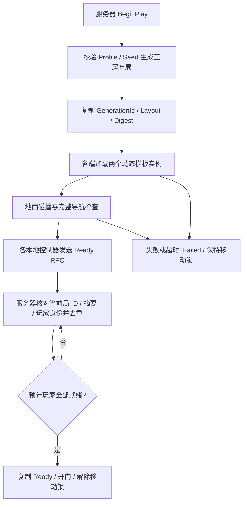

# Roguelike 关卡生成：增量一

用户已批准需求文档中的全部推荐基线。本增量建立可运行的三房间装配与双人同步基础；完整的 14～18 房主支路及房间玩法按后续增量实现。

## 当前可以体验什么

打开 `/Game/RoguelikeGeneration/Maps/L_DungeonGenerationProbe`，直接 Play。入口在持久关卡中，战斗房和终点房从独立模板动态加载。Seed 决定两个房间的位置与旋转；同配置、同 Seed 可复现。

这里的 Combat/Boss 是房间用途标记，尚未刷怪，也没有 Boss 战。三房间用于验证生成器能安全落到真实场景中。

在 Outliner 选中 `RG_GenerationRuntime`：

| 参数 | 用法 |
|---|---|
| Seed | 默认为 42；137 可看到另一种排列。停止 PIE 后再修改。 |
| Expected Players | 单人设 1；双人 Listen Server 测试设 2，同时在 Play 设置中选择 2 名玩家。当前不会自动读取旅行队伍。 |
| Profile | `DA_DungeonAssemblyProbe`，引用入口定义与两个房间模板。 |

双人模式中，服务器生成清单并复制到客户端。每端等房间可见、地面碰撞、门口 Pawn 胶囊扫掠、接缝地面支撑及导航路径通过后，通过自己的 PlayerController 报告就绪。服务器收到两人确认后才开放入口；等待期间移动输入被锁定。人数不足 30 秒后进入 Failed，停止 PIE 并修正设置再试。

## 代码与资产分工

| 位置 | 职责 |
|---|---|
| `Source/test_25d/Public/Roguelike`、`Private/Roguelike` | 数据、纯布局生成、校验、运行时装配、复制与就绪 RPC。 |
| `Private/Tests/DungeonGenerationTests.cpp` | 可复现性、布局约束、错误输入与就绪账本测试。 |
| `Content/RoguelikeGeneration/Rooms` | 仅含环境的手工房间模板；不放玩家、刷怪器或生成器。 |
| `Content/RoguelikeGeneration/Maps` | 固定入口、两个带槽位的 TravelPlayerStart、动态导航与生成器。 |
| `Scripts/RoguelikeGeneration` | 编辑器制作、MCP 入口、PIE 验证；不参与游戏运行时。 |

房间使用 2400 cm 网格、800 cm 四向门。连接使用的门保持可通行，未使用的门封闭。入口安全门在全队就绪前阻挡玩家，但不影响生成阶段的结构导航校验。当前模板尺寸、门宽和安全门尺寸应作为一个整体维护。

新控制器继承 PureMassPlayerController；复制现有蓝图保留其输入、玩家、HUD 与 GAS 配置。宿主使用 `RG_Entrance` 默认入口组、槽位 0/1，适配项目已有出生流程。原地图和原蓝图未修改。

## 调用流程



同一清单的 RepNotify 不重复加载。动态实例名包含本局 GenerationId 与 RoomId，两端一致；EndPlay 请求卸载并清理门组件。本增量重新生成需要重新启动世界，不提供同一世界内热重生成。

## 调试与复测

蓝图或 Unreal Python 可调用生成器的 `GetGenerationReport()`，得到 JSON：本局 ID、摘要、Seed、阶段、具体错误、等待原因、加载房间数、确认人数、门状态以及每个房间的位置/资源。它是 MCP 读取运行状态的稳定入口；MCP 返回成功仅代表工具执行，仍须检查业务报告。

外部调用：`python Scripts/RoguelikeGeneration/editor_bridge.py <tool> --file <request.json>`。桥接器验证项目和编辑器实例，带当前世界独占锁并保存回执；未知结果不会自动重提。编辑器脚本通过 `console_exec` 的 `py "绝对路径"` 执行。

常用脚本：

- `author_probe.py`：只制作新目录资产；已有完整输出只校验，部分输出报错并等待定位，不盲目覆盖。
- `prepare_probe.py`：读取 `Saved/RoguelikeGeneration/verify-request.json`，临时设置 Seed/人数；`{"restore":true}` 恢复原值。缺模板测试使用临时 Profile，不保存故障配置。
- `verify_probe.py`：先注册 Slate 回调，再启动 PIE；输出真实世界的装配、导航、碰撞与门控报告。
- `verify_movement.py`：在已 Ready 的 PIE 中注入现有移动动作，检查本地和服务器角色的实际位移及位置一致性。

单人请求示例：

```json
{"label":"pie-single-42","expected_worlds":1,"expected_players":1,"seed":42,"timeout":75}
```

双人将两项数量改为 2，并用 `pie_start` 参数 `{"num_players":2,"net_mode":1,"mode":"viewport"}`。脚本的 `expected_players` 是测试断言，必须先运行 prepare 脚本使地图配置一致。

## 验证记录

构建使用完整 `test_25dEditor Win64 Development`，包括 UHT。自动化先观察新增 4 项失败，再实现并通过；项目完整测试报告为 66 项成功、0 项失败、0 项未运行。

| 场景 | 已观察结果 | 报告 |
|---|---|---|
| 单人 Seed 42 | 3 房、2 动态实例，地面/接缝/门口碰撞与 3 条导航路径通过 | `Saved/RoguelikeGeneration/pie-single-42.json` |
| 双人 Seed 42 | 两端 ID、摘要和布局一致，服务器收到 2 人确认后放行；修复后重测通过 | `Saved/RoguelikeGeneration/pie-duo-final-42.json` |
| 单人 Seed 137 | 另一种布局与旋转，装配和导航检查通过 | `Saved/RoguelikeGeneration/pie-single-final-137.json` |
| 要求 2 人但仅进入 1 人 | 30 秒超时，`ReadyTimeout:WaitingForPlayers`，入口关闭、移动锁保留 | `Saved/RoguelikeGeneration/pie-timeout.json` |
| 模板资源缺失 | `TemplatePackageMissing:Combat`，移动锁保留 | `Saved/RoguelikeGeneration/pie-missing-template.json` |
| 不参与导航且忽略 Visibility 的门口阻挡 | 修复前错误 Ready；修复后 `ReadyTimeout:DoorwayCollisionBlocked:R01->R02`，保持关门 | `Saved/RoguelikeGeneration/pie-blocked-door-red.json`、`pie-blocked-door-green.json` |
| 双人实际移动 | 两名玩家分别移动约 229 / 232 cm；远端位置复制误差小于 0.001 cm | `Saved/RoguelikeGeneration/movement.json` |
| 全部 C++ 自动化，审阅修复后重跑 | 66/66 | `Saved/RoguelikeGeneration/full-suite-final/index.json` |

每端成功检查覆盖 9 个地面采样、12 个门口、2 处接缝及 3 条完整非 partial 路径。测试记录了 Loading、WaitingForPlayers、Ready 的真实状态转移。截图位于 `Saved/RoguelikeGeneration/probe-player.png`。

本轮验证环境是编辑器内同进程 PIE，尚不等于打包版本或独立进程联机验证。动态地图的 Cook 清单见 `authoring.json`；正式打包前需将宿主和两个模板纳入 Cook，并独立验证。未实现断线重连、跨进程存档恢复或主机迁移。

独立审阅发现的门口物理碰撞问题已通过上述红→绿回归修复，没有遗留的 Critical、Important 或 Minor 项。审阅边界的处理如下：完整房间玩法与打包延后按原分期实施；固定人数仍由地图参数指定；二进制资产以重新打开后的属性校验和真实 PIE 为证；移动已补充实际输入动作验证，但物理键盘焦点、手感及技能强制位移属于后续玩法联调范围。失败路径均由实际 PIE 报告补齐。这些边界不应被理解为完整游戏或发布版本验收。

## 下一增量

在当前装配与同步接口上增加正式主支路图：主线 10～12 房、支路 4～6 房，按已批准的宝箱、精英、商人、休息与 Boss 配额分配节点，进行有上限的回溯与可复现降级。先验证批量 Seed 的图约束，再扩展模板库、房间遭遇状态、Mass 刷怪和战斗门控；奖励、商店及探索地图继续分增量接入。
