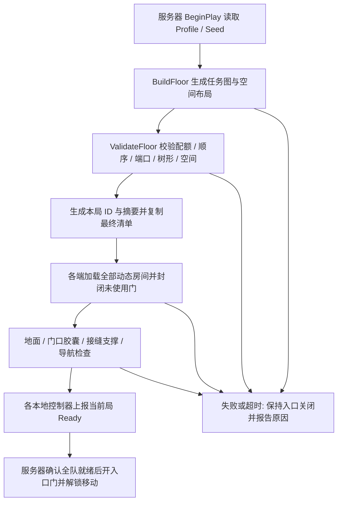

# Roguelike 关卡生成：增量二

本增量将三房间装配基础扩展为完整的 14～18 房主支路关卡，增加有界搜索、确定性备用布局、11 种房间模板和开发者布局预览。原三房间探针继续保留，用于基础装配与联机回归。

## 当前可以体验什么

打开 `/Game/RoguelikeGeneration/Maps/L_RoguelikeFloor`，直接 Play。入口固定在持久关卡原点，其他房间根据 Seed 从独立模板动态加载。默认 Seed 为 42、Expected Players 为 1，使用 `/Game/RoguelikeGeneration/DA_RoguelikeFloor`。

在 Outliner 中选中 `RG_GenerationRuntime`，停止 PIE 后修改 Seed，再次 Play 即可生成另一层。双人 Listen Server 测试需要将 Expected Players 设为 2，并在 Play 设置中选择 2 名玩家；当前仍由地图参数指定人数，不自动读取旅行队伍。同一世界内的热重生成尚未开放，重新生成需要重新启动 PIE 或世界。

服务器生成最终清单并复制给客户端，各端加载相同房间、位置和朝向。所有房间可见、地面与门口碰撞、接缝支撑、导航路径以及全队 Ready 确认通过后，入口安全门才打开并解除移动输入锁。就绪超时默认为 30 秒；失败时入口关闭，报告保留具体原因。

房间中的 Combat、Treasure、Elite、Merchant、Rest、Boss 目前是用途标记。模板通过不同角落布置、文字和灯光颜色区分用途，没有接入怪物遭遇、宝箱奖励、商人交易、休整交互或 Boss 战。场景内没有自动刷怪器；开发者预览也不是玩家探索地图。

## 生成规则

| 范围 | 当前规则 |
|---|---|
| 全层 | 主线 10～12 房，支路合计 4～6 房，总计 14～18 房；入口只出现一次。 |
| 主线配额 | 普通战斗 4～6 房；入口、宝箱、精英、商人、休整、Boss 各 1 房。 |
| 主线顺序 | 入口后的前两房为普通战斗；精英前至少有 3 个普通战斗房；宝箱在精英前，商人在精英后、休整前；休整紧邻最终 Boss。 |
| 战斗节奏 | 主线上连续战斗房最多 3 个，精英计入连续战斗。 |
| 支路 | 2～3 条，每条 1～3 房；只挂接主线一次，不挂在入口、休整或 Boss 上；中间房为普通战斗，末端为宝箱或精英。 |
| 全层奖励配额 | 宝箱总计 2～3 房；主线精英 1 房，支路精英至多 1 房。 |
| 连通结构 | 所有房间可达，图为树；支路不会绕过主线必经节点。房间物理相邻但没有图连接时，对应门仍封闭。 |
| 空间 | 固定 2400 cm 方形网格，四向门宽 800 cm，旋转以 90° 为单位；入口固定在原点且不旋转。 |
| 搜索上限 | 默认网格半径 12，最多 8 次装配尝试，每次最多 2000 次候选搜索；不依赖机器运行时间决定布局。 |

生成先确定满足用途与顺序约束的任务图，再安排网格位置和可兼容的房间模板。任务图、空间和模板选择使用独立的随机流，模板列表排序变化不会改变同输入的结果。战斗模板池不足时可以放宽相邻战斗模板的多样性，并通过 `diversity_relaxed` 报告。

常规搜索耗尽时，可使用确定性的备用主干与支路布局。备用布局仍须通过配额、顺序、模板端口和空间校验，以及运行时的碰撞与导航检查；它不会减少房间或跳过验证。`used_fallback` 会明确标记本次是否采用备用；关闭 `allow_fallback` 后，预算耗尽会明确失败。

## 代码与资产分工

| 位置 | 职责 |
|---|---|
| `DungeonGenerationTypes.h`、`DungeonGenerationProfile.h` | 房间用途、模板端口、主支路元数据、数量范围和搜索预算。 |
| `DungeonFloorGenerator.cpp`、`DungeonLayoutLibrary.h/.cpp` | 不依赖世界装配的布局生成、完整规则校验与稳定序列化。 |
| `DungeonGenerationRuntime.cpp` | 根据 Profile 选择三房探针或完整层模式，复制清单、加载模板、封门、验证就绪并输出运行报告。 |
| `Private/Tests/DungeonFloorGenerationTests.cpp` | 批量 Seed、确定性、模板排序、备用与有界失败、被篡改布局拒绝测试。 |
| `Scripts/RoguelikeGeneration/author_floor.py` | 制作并重新读取验证本增量资产，导出 Cook 地图清单。 |
| `preview_floor.py`、`verify_floor.py`、`run_floor_checks.py` | 纯布局预览、真实 PIE 世界验证、串行批量测试及设置恢复。 |

完整层使用 `DA_RoguelikeFloor` 的 `Generate Full Floor = true`；原探针 Profile 保留原模式。新模板库共 11 种定义：宿主内固定入口 1 种，动态战斗房 `L_Floor_CombatA/B/C/D/E` 共 5 种，以及 `L_Floor_Treasure`、`L_Floor_Elite`、`L_Floor_Merchant`、`L_Floor_Rest`、`L_Floor_Boss` 各 1 种。动态地图均位于 `/Game/RoguelikeGeneration/Rooms`。一层可以多次实例化同一模板，动态实例数始终为总房间数减 1。

每个新房间和新宿主入口都有隐藏的实心碰撞底板：尺寸 2402×2402×20 cm，顶面 Z=0，四边各比 2400 cm 的可见房间外伸 1 cm，使用 `BlockAll`。它使旋转后相接的地面仍连续支撑玩家，不改变网格间距、可见房间尺寸或门宽；未连接方向仍由封门阻挡。新宿主保留原入口出生槽位 0/1、`RG_Entrance` 入口组及现有控制器/模式，动态导航范围扩展为 XY 半径 31200 cm。

资产制作只写本增量的新路径。完整输出已存在时，`author_floor.py` 只重新读取验证；部分输出、未保存的外部修改或属性不一致会明确报错，不自动覆盖。报告为 `Saved/RoguelikeGeneration/authoring-floor.json`，包含宿主、模板、碰撞底板、导航和 `cook_maps` 清单。

## 调用流程与工具接口



| 接口 | 用途 |
|---|---|
| `UDungeonLayoutLibrary::BuildFloor(Profile, Seed, OutLayout, OutError)` | 生成完整层数据；不加载房间或生成 Actor。蓝图与 Unreal Python 可调用。 |
| `ValidateFloor(Profile, Layout, OutError)` | 独立验证完整层布局，供生成后检查、工具和测试复用。 |
| `CanonicalLayout(Layout)` | 输出稳定布局字符串，用于复现比较和摘要；耗时等运行诊断不参与布局身份。 |
| `ADungeonGenerationRuntime::GetGenerationReport()` | 返回当前实际世界的 JSON，供 MCP、脚本和蓝图诊断。 |

运行报告包含 `generation_id`、`digest`、`seed`、`layout_version`、`phase`、`error`、`pending`、加载数、确认人数、门状态，以及本增量增加的 `main_path_length`、`used_fallback`、`diversity_relaxed`、`placement_attempts`、`search_steps`、`generation_ms`。每个房间提供稳定 `id`、用途、模板、资源、网格/世界坐标、旋转、`main_index` 和 `branch_id`；`connections` 的 `from/to` 指向 `rooms` 数组索引。不属于主线或支路时，对应归属值为 -1。

MCP 沿用项目绑定桥接器 `editor_bridge.py`，核对项目与编辑器实例、持有当前世界独占锁并记录回执。工具执行成功与关卡业务验证成功分别检查：必须继续读取 JSON 中的 `passed`、`checks`、`error` 和清理结果。调用结果未知时先检查回执和编辑器状态，不自动重复提交。不要并行启动多个批次或多个当前世界操作。

## 预览与批量复测

以下外部命令在项目根目录执行，编辑器应已加载当前编译版本。预览使用 Unreal Python；它只读取 Profile 并输出调试文件，不启动 PIE、不生成 Actor、不保存 Unreal 资产。

先写入 `Saved/RoguelikeGeneration/floor-preview-request.json`：

```json
{"seed":42,"profile":"/Game/RoguelikeGeneration/DA_RoguelikeFloor","preview_label":"floor-preview-42"}
```

停止 PIE，在编辑器 Output Log 的命令输入框执行：

```text
py "C:/Users/greedy/Documents/Unreal Projects/test_25d/Scripts/RoguelikeGeneration/preview_floor.py"
```

结果为 `Saved/RoguelikeGeneration/floor-preview-42.json` 和同名 `.html`。HTML 内嵌 SVG，展示房间用途、主支路、坐标、朝向和连接，支持缩放与悬停查看模板。JSON 保存完整布局、稳定字符串与 SHA-256，适合比较同 Seed 的生成结果。

通过 MCP 调用同一预览时，将下面内容保存为请求文件，例如 `Saved/RoguelikeGeneration/preview-command.json`：

```json
{"command":"py \"C:/Users/greedy/Documents/Unreal Projects/test_25d/Scripts/RoguelikeGeneration/preview_floor.py\""}
```

```powershell
python Scripts/RoguelikeGeneration/editor_bridge.py console_exec --file Saved/RoguelikeGeneration/preview-command.json
```

真实装配验证使用批次工具。先打开并保存 `L_RoguelikeFloor`，停止 PIE，确保没有未保存的地图或资产修改：

```powershell
python Scripts/RoguelikeGeneration/run_floor_checks.py --single-count 20 --duo-count 10 --start-seed 0 --label floor-batch-latest
```

此命令依次运行单人 Seed 0～19 和双人 Seed 0～9，逐次停止 PIE，检查单/双人相同 Seed 的摘要与布局一致性。默认每次验证超时 90 秒；生成器自身 30 秒的就绪超时仍生效。批次结束时尝试恢复开始前的 Seed、Expected Players 和 Profile，不保存临时测试配置。汇总写入 `Saved/RoguelikeGeneration/floor-batch-latest.json`，每次批次的详细记录保存在 `batches/<batch_id>/summary.json` 及其中引用的逐局报告。

快速复测修复后的 Seed 42：

```powershell
python Scripts/RoguelikeGeneration/run_floor_checks.py --single-count 1 --duo-count 0 --start-seed 42 --label floor-smoke-42-repeat
```

强制走备用布局的测试命令如下。它临时复制 Profile 并将搜索预算设为一次尝试、一步搜索，结束后恢复原 Profile：

```powershell
python Scripts/RoguelikeGeneration/run_floor_checks.py --single-count 1 --duo-count 1 --start-seed 42 --force-fallback --label floor-fallback-42
```

底层 `verify_floor.py` 读取 `Saved/RoguelikeGeneration/floor-request.json`，先注册 Slate 回调，再观察真实 PIE 世界；批次工具负责按正确顺序启动它和 PIE。验证包括用途/主支路规则、全房间加载、两端清单与摘要、所有四向门的开闭、每房地面采样、逐边接缝支撑、逐边完整导航，以及入口到 Boss 和各支路终点的路径。它还采样就绪前门控，并检查 Ready 后输入锁解除；实际移动输入仍由 `verify_movement.py` 单独验证。

## 验证记录

纯生成数据取自最新完整套件运行。耗时只统计布局计算，不包含模板流送、导航构建、碰撞检查、网络等待或玩家加载时间，也不是其他设备的性能承诺。

| 场景 | 已观察结果 | 报告 |
|---|---|---|
| 纯生成 1000 个 Seed | 全部通过规则校验，备用次数 0；最终运行 P95 约 0.038 ms | `Saved/RoguelikeGeneration/floor-seed-metrics.json` |
| 前 100 个 Seed 多样性 | 完整布局、含用途/模板的任务图和空间布局分别为 100 个唯一结果，用途顺序为 96 种；图指标不等同于忽略节点属性后的纯拓扑数量 | 同上 |
| 修复后项目完整 C++ 自动化 | 71 项成功，0 项失败，0 项未运行 | `Saved/RoguelikeGeneration/floor-final-suite/index.json` |
| 新资产制作与重新读取 | 12 个新资产、11 个地图验证通过，包含碰撞底板；保存后无脏包 | `Saved/RoguelikeGeneration/authoring-floor.json` |
| Seed 42 初次 PIE | 暴露 `DoorwayFloorMissing:R04->R05`，入口保持关闭 | `Saved/RoguelikeGeneration/floor-smoke-42.json` |
| Seed 42 修复后 PIE | 17 房、16 个动态实例，装配、通路、导航和就绪验证通过 | `Saved/RoguelikeGeneration/floor-smoke-42-fixed.json` |
| 单人 20 个 Seed | Seed 0～19 全部通过，生成 14～18 房 | `Saved/RoguelikeGeneration/floor-baseline-30.json` |
| 双人 10 个 Seed | Seed 0～9 全部通过；10 组与单人相同 Seed 的摘要、完整布局相同 | 同上 |
| 强制备用布局 | Seed 42 单人及双人均通过，保留全部 17 房及通路检查 | `Saved/RoguelikeGeneration/floor-forced-fallback.json` |
| 要求 2 人、实际 1 人 | 30 秒后 `ReadyTimeout:WaitingForPlayers`，本地装配完成、确认人数 1、门关闭、输入锁定 | `Saved/RoguelikeGeneration/floor-timeout-42.json` |
| 缺少商人模板 / 禁止备用且预算耗尽 | 明确报告对应错误，输入保持锁定 | `Saved/RoguelikeGeneration/floor-edge-cases.json` |
| 双人真实移动动作 | 两人实际位移约 237 / 240 cm，远端位置复制误差小于 0.001 cm | `Saved/RoguelikeGeneration/floor-movement-duo.json` |
| 原三房探针回归 | 原地图 Seed 42 的加载、碰撞、导航和就绪验证通过 | `Saved/RoguelikeGeneration/floor-old-probe-regression.json` |

初次失败位于一个旋转 180° 的房间与相邻房间的接缝。实际射线检测发现：接缝精确中心漏检，两侧偏移 0.1 cm 即可命中。原可见地砖以三角面边界相接，旋转后的浮点位置差使精确边界存在支撑检测空隙。修复为本增量全部 11 个地图添加每边外伸 1 cm 的实心碰撞底板，保留严格的接缝射线校验；没有通过放宽验证阈值掩盖问题。作者脚本也增加了底板的生成和重新读取检查。

本轮验证环境为编辑器内 PIE，双人为同进程 Listen Server；这些结果不等同于打包版本、独立客户端进程或专用服务器验收。打包前应依据 `authoring-floor.json` 的 `cook_maps` 将新宿主及 10 个动态模板纳入 Cook，并另行验证软引用资源、跨进程复制和加载时间。

独立全增量审阅确认的唯一重要问题为上述地面接缝，已通过失败复现、连续碰撞底板修复和完整批量 PIE 回归解决，没有遗留的审阅问题。1 cm 的底板外伸是保持连续支撑的容差；它会在房间视觉边界外多出 1 cm 碰撞边缘，该边缘位于封墙后，所有门和路径均纳入实际检查。移动验证通过 Enhanced Input 注入现有动作，覆盖角色移动和服务器复制，不代表物理键盘焦点、手感或所有房间的实走验收。

批次恢复参数后，编辑器仍可能把宿主标为未保存。请先确认 Seed、Expected Players、Profile 已恢复，再只保存该宿主；不应保存故障注入的临时 Profile。本次交付恢复为 Seed 42、Expected Players 1、原完整层 Profile，PIE 停止。

## 下一增量

在已生成并可通行的房间图上接入房间遭遇状态、Mass 刷怪和战斗门控，再逐步接入宝箱奖励、商店、休整和 Boss 完成条件。玩家探索地图、跨层进度、断线重连、存档恢复及发布打包仍需后续独立验收。
