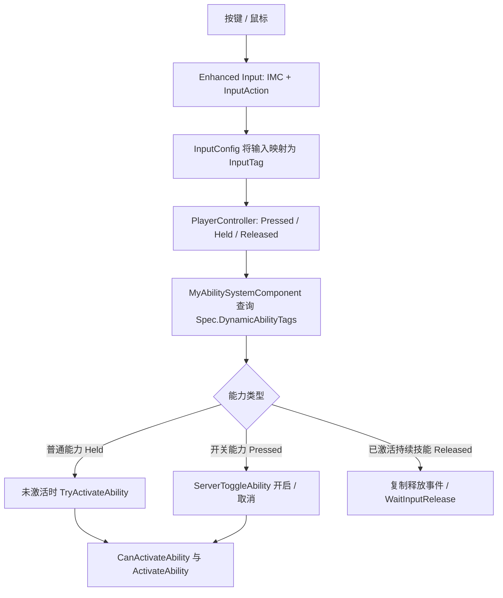
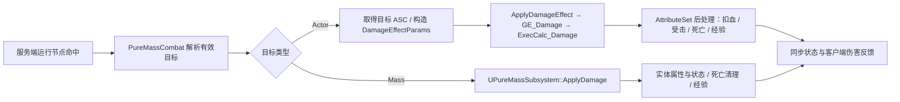

# GA 制作与调用全流程

本文于 2026-10-31 补充制作流程，基础执行器说明沿用 2026-10-26 实现，覆盖「提出需求 → 选择执行器 → 编写逻辑 → 制作资产 → 接入角色、菜单与存档 → 输入激活 → 联机目标与伤害 → 表现 → 清理 → 验证」。GA 是 GameplayAbility；制作一个 GA 不只是创建一个同名蓝图。

[返回项目首页](../README.md) · [主要功能清单](project-feature-catalog.md) · [build-ga 技能](../skills/build-ga/SKILL.md)

## 可复用制作检查表

| 阶段 | 操作 | 完成依据 |
|---|---|---|
| 定义需求 | 稳定 ID、目标、范围、伤害、消耗、冷却、时序、取消、联机与接入方式 | 形成技能设计卡；未指定参数注明采用的默认值 |
| 查找复用 | 读取最近似 GA、原型执行器、目标适配、现有目录与工作区状态 | 确认 Actor/Mass 路径和共享资产影响，不从素材包示例直接推定可用 |
| 实现逻辑 | 单一执行入口；服务端 Commit 与结算；失败、死亡、取消和换图清理 | C++ 编译成功，行为/边界测试覆盖实际新增机制 |
| 配置资产 | 原生类型编译加载后，再制作 GA/GE/Tag/DA、蒙太奇和 Cue/Niagara 引用 | 创建脚本可控重跑、保存成功、独立进程读回；不覆盖其他设计师数据 |
| 接入玩法 | 正确目录、授予/学习、输入槽、UI 描述图标、持久化 | 实际角色能学习/触发，旧槽位及旧存档仍有效 |
| 验证数值 | 消耗一次、伤害一次、目标过滤、持续效果与独立移除 | 实际 ASC/属性或 Mass 伤害结果；不是仅检查 GA 或 GE 存在 |
| 验证表现 | 真实动画播放、命中帧、发射点、预警、特效与取消 | 运行时姿态和画面证据；参数读回不替代视觉验收 |
| 联机与交付 | 客户端触发、服务器复核、远端表现、旅行恢复 | 新鲜报告、试玩步骤、明确待验收项；不以单机结论代替双端验证 |

调用 `$build-ga` 时按以上阶段推进；只改数值时执行相关资产与运行验证即可，不强制重建全部系统。制作技能不会自动授权提交 Git；本次发布按用户明确指令执行。

| 需求类别 | 使用流程 | 特别约束 |
|---|---|---|
| 玩家主动/持续/被动 GA | 本文 + [build-ga](../skills/build-ga/SKILL.md) | 学习、输入、消耗、技能栏与保存恢复 |
| 敌人攻击 GA | 本文 + [怪物规范](monster-development-standard.md) + [怪物制作流程](monster-production-workflow.md) | 预警、真实动画命中、死亡/复用清理和 AI 标签入口 |
| 固定/随机装备数值 | [装备制作流程](equipment-production-workflow.md) + [build-equipment](../skills/build-equipment/SKILL.md) | 每件独立 Infinite GE、服务器实例、Tag/Modifier 匹配；不是每个词条新建 GA |

敌人技能的最低顺序是选定目标 → 预警/前摇 → 锁定与命中 → 后摇 → 结束。读取最新对象池实现；死亡、眩晕和回收要使旧攻击代次失效。蒙太奇未播放或被打断时不能照常补发伤害。普通攻击与范围攻击的预警要求以怪物规范为准。

## 1. 先选择项目中实际存在的实现路径

| 路径 | GA / 配置 / 执行器 | 适用情况与边界 |
|---|---|---|
| 传统 Actor/GAS | `UMyGameplayAbility` / `UMyDamageGameplayAbility` 的派生类，配合 GA、GE、Cue、动画蓝图 | 复用原 FireBolt、Beam、近战、被动，或像 ArcaneNova 一样编写专用能力；不能假设所有旧技能自动支持 Mass |
| 前四批 Actor 原型 | `UPrototypeAbility` + `UAbilityPrototype` + `APrototypeRuntime` | 18 种行为，使用 `OnHit / OnPeriod / OnExpire` 组合；原版执行器以 Actor 目标为主 |
| 前四批混合目标原型 | `UPureMassAbility` + `UAbilityPrototype` + `APureMassRuntime` | Mass 目录中的 26 个 GA 副本，使用 Actor/Mass 混合目标接口；玩家仍是 Actor/GAS |
| 第五批扩展 | `UExtensionAbility` + `UExtensionNode` + `AExtensionRuntime` / `UExtensionWorldSubsystem` | Attach、Stack、Displace，以及本执行器实现的 Projectile、Chain、Burst、Delay、Surface；使用 `HitChild / PeriodChild / CompleteChild` |

第五批的 `UExtensionNode` 虽继承 `UAbilityPrototype`，实际行为由 **Behavior** 决定。不要用继承字段 **Kind** 代替 Behavior，也不要把旧版 `OnHit / OnPeriod / OnExpire` 填到扩展图中：`ValidateGraph()` 会拒绝这些连接。旧原型资产不能直接当作扩展子节点。

代码入口：[原型 GA](../Source/test_25d/Private/AbilitySystem/Prototypes/PrototypeAbility.cpp)、[混合 GA](../Source/test_25d/Private/PureMass/PureMassAbility.cpp)、[扩展 GA](../Source/test_25d/Private/AbilitySystem/PrototypeExtensions/ExtensionAbility.cpp)。

## 2. 将技能需求写成可验收的规格

在动手前明确以下内容，保存到本能力的设计记录中：

| 项目 | 需要确定的内容 |
|---|---|
| 身份与入口 | 英文 ID、中文名、主动 / 持续 / 开关 / 被动；玩家使用还是敌人使用 |
| 目标 | 自身、鼠标地面、指定敌人；Actor、Mass 或两者；敌我、死亡、墙体和不同楼层规则 |
| 时间与空间 | 射程、范围、速度、周期、寿命、触发延迟、数量上限 |
| 战斗 | 伤害类型、基础伤害、等级增长、状态、击退 / 牵引、目标免疫 |
| 资源 | 开启 / 单次 MP、每秒 MP、冷却；空放、目标失效、生成失败如何处理 |
| 生命周期 | 松键停止、再次按键关闭、施法者死亡、目标死亡、卸下、换图时的行为 |
| 表现 | 动画 / 蒙太奇、发射点、循环与命中特效、音效、伤害数字 |
| 接入 | 可学习或初始授予、技能目录、菜单、输入槽、存档、联机验证场景 |

新玩家技能通常登记为可学习，**不会自动挤占初始按键槽**。不能只增加一个 `Damage.Ice` 标签就宣称新增冰系伤害；当前元素与抗性映射要以 `MyGameplayTags`、AttributeSet 和 ExecCalc 为准。冰霜地表的减速与视觉也不等同于新增伤害元素。

## 3. 逻辑、配置与资产如何分工

### 3.1 最小交付清单

| 对象 | 必须配置 / 检查的内容 |
|---|---|
| GA 蓝图 | 正确父类、独立 AbilityTag、配置引用、网络策略、阻止激活条件、伤害 GE；初始装备时才设置 StartupInputTag |
| 原型 DA / 扩展节点 DA | 根节点数值、子节点引用、独立显示名、简短描述、图校验 |
| Cost / Cooldown | 传统能力配置对应 GE；原型与扩展通过覆写 Cost/Cooldown 读取 DA，不能再加第二套扣费逻辑 |
| 伤害 | Actor 使用既有 `GE_Damage` / ExecCalc；Mass 交给实体伤害接口，不能对不存在的怪物 ASC 调 GE |
| 表现 | Cue 或运行时复制特效；需要施法动作时单独接蒙太奇与动画事件，不是每个 GA 都必须有 Cue 或蒙太奇 |
| 技能目录 / UI | `AbilityTag`、`CooldownTag`、`AbilityType`、等级要求、GA 类、图标和背景；运行时再填输入与状态 |
| 角色与测试关卡 | 正确的 GameMode、Pawn、Controller、HUD 及 WidgetController 目录引用 |
| 验证 | 资产读回脚本、核心行为测试、PIE 场景与报告，说明哪些实际执行过 |

标签职责要分开：`Abilities.*` 是技能身份，`Cooldown.*` 是冷却，`GameplayCue.*` 是表现，`InputTag.*` 是装备槽，`Abilities.Status.*` 是运行时学习状态。同一个身份的 Actor 与 Mass 替代类应在各自目录中解析，避免同时授予导致重复和存档歧义。

### 3.2 编写或复用 C++

同一行为只改数值或节点关系时，复制独立 DA / GA 并配置即可。新增行为时，先实现对应执行器的验证、执行、目标适配、网络表现与清理，再制作资产。

- 传统完整原生能力参考 [MyArcaneNova.cpp](../Source/test_25d/Private/AbilitySystem/Ability/MyArcaneNova.cpp)：父类执行完整流程，蓝图只配参数，不再放第二套 Activate / Commit。
- 原型参数参考 [AbilityPrototype.h](../Source/test_25d/Public/AbilitySystem/Prototypes/AbilityPrototype.h)：`DamagePerLevel`、Range、Radius、Period、Duration、LoopVFX、ImpactVFX 等。
- 扩展参数参考 [ExtensionNode.h](../Source/test_25d/Public/AbilitySystem/PrototypeExtensions/ExtensionNode.h)：EffectId、StackThreshold、MaxTransfers、MoveDistance、免疫类 / 标签 / Mass 类型等。
- 新身份标签要先注册，再写引用这些标签的资产。第五批在 [ExtensionIntegration.cpp](../Source/test_25d/Private/AbilitySystem/PrototypeExtensions/ExtensionIntegration.cpp) 中注册身份与冷却标签。

新增反射类型、属性或原生标签后，完整编译 `test_25dEditor` 并重新加载编辑器，再验证新类型可被 Unreal Python 找到。仅编译成功不能证明正在运行的编辑器已经加载新类型。构建环境和本项目 Unity 兼容配置见 [README](../README.md#快速试玩)。

### 3.3 一个完整的资产组合示例：三重焰印

现有资产位于 `/Game/PrototypeExtensions/Batch5/`，以下是已实现配置，不是尚待创建的示例技能。

```text
GA_EmberBrand : UExtensionAbility
  Prototype → DA_EmberBrand              Behavior = Projectile
                 HitChild → DA_EmberBrand_Mark     Behavior = Stack
                               CompleteChild → DA_EmberBrand_Blast
                                                    Behavior = Burst
```

| 配置对象 | 核心参数 |
|---|---|
| `GA_EmberBrand` | `Abilities.Extension.EmberBrand`；非自身目标，LocalPredicted；StartupInputTag 为空，默认通过菜单装备 |
| `DA_EmberBrand` | 8 MP、0.8 秒冷却；Fire；基础伤害 12、每级 +2；Speed 900、Duration 3、CollisionRadius 12；命中连接印记 |
| `DA_EmberBrand_Mark` | `EffectId=Extension.EmberBrand`；3 层；StackLifetime 4 秒；达到阈值后默认延时 0.4 秒引爆 |
| `DA_EmberBrand_Blast` | Fire；基础伤害 35、每级 +2；Radius 180；爆炸表现 |
| `DA_AbilityInfo` | 登记身份、冷却、GA 类、进攻类型、等级要求和图标；输入槽与状态不硬编码为 Equipped |

制作同类新技能时先复制三个 DA，**重新连接到自己的子节点**，再复制 GA 指向新根节点；独立技能使用独立身份、冷却与 EffectId。只复制根节点而继续引用旧子节点，会使后续调参影响两个技能。

图校验要求：无循环，派生深度不超过 3；Attach 必须有 PeriodChild，Stack 必须有非空 EffectId 和 CompleteChild；Surface 必须有 SurfaceClass，Delay 的 ArmDelay 不得大于 Duration。当前每次施法最多 64 个运行节点，扩展地表最多 8 块，世界最多 256 条印记记录。详见 [ExtensionNode.cpp](../Source/test_25d/Private/AbilitySystem/PrototypeExtensions/ExtensionNode.cpp)。

### 3.4 如果制作的是传统 GA / GE / Cue 技能

以 ArcaneNova 的制作方式为参考，补齐以下资产链；原型执行器已经覆写消耗 / 冷却时不要重复照做。

1. 创建正确原生父类的 GA 蓝图，设置独立身份、`DamageEffectClass`、伤害类型和等级数值。检查父类 Debuff / 击退默认值，避免技能意外继承不需要的效果。
2. 创建独立 Cost GE：Instant、`MyAttributeSet.Mana`、Additive；20 MP 对应数值 -20。固定消耗时清掉模板遗留的 CurveTable / RowName，并读回 Modifier 的属性和运算。
3. 创建独立 Cooldown GE：HasDuration，填写持续时间；UE 5.8 项目使用 `ge_components` 中的 `TargetTagsGameplayEffectComponent` 授予自己的冷却标签，同时去掉模板旧标签。只改显示文本或旧 OwnedTags 字段不足以证明冷却生效。
4. 将 Cost / Cooldown GE 引用配置到 GA，确保目录的 CooldownTag 与实际授予标签一致；运行中核对 ASC 获得标签、到期移除、再次施法受到限制。
5. 需要 Cue 时建立 Tag → GC 映射，确认 Config 中 GameplayCueNotifyPaths 覆盖资产目录，设置 Niagara 与声音；专用服务器跳过视听。持续 Cue 还需明确添加 / 移除，不能只实现播放入口。
6. 需要动作时接入正确角色的蒙太奇、发射 Socket、动画通知与 GameplayEvent，再由事件调用投射或伤害逻辑；完成、打断、取消都收尾。像 ArcaneNova 这样的即时脉冲没有蒙太奇等待，无需人为增加第二个入口。
7. 编译保存 GA / GE / GC，独立读回后按第 5 节接入目录、角色和 UI。

完整已制作案例见[奥术新星](2026-10-21-arcane-nova-guide.md)；生命周期更复杂的开关技能见[环绕火球](2026-10-21-orbiting-fire-bolt-guide.md)。

## 4. 使用 build-ga 与 MCP 完成制作

### 4.1 自然语言入口

可以调用项目已有技能，例如：

```text
$build-ga 新建三重雷印：兼容 Actor 和 Mass，投射物命中叠加印记，
三层后在目标附近爆炸；复用第五批 Stack 和 Projectile，
耗蓝 8、冷却 1 秒，菜单可学习，默认不装备，保留原资产与存档。
```

这是制作指令示例，**本文没有新增这个技能**。执行时按 [SKILL.md](../skills/build-ga/SKILL.md) 产生代码、专用资产脚本、接入与验证结果。

### 4.2 编辑器执行顺序

1. 检查工程、分支、未保存资产与当前 PIE 状态，确定本次新增目录和复用资源。
2. 编译并加载必要原生类型；通过 MCP 握手确认 projectPath / instanceUuid。
3. 发现真实工具 schema，读取模板父类、GA CDO、蓝图执行图、目录与输入槽。
4. 将创建脚本放入 `Scripts/GA/<本批或技能>/`。不存在才创建；存在时先核对类型与身份，再按明确范围更新。
5. 按「子 DA → 根 DA → GA → 目录 → HUD / 角色 / 地图」设置引用，编译蓝图并保存。
6. 独立读回资产与关键引用，完成运行验证，输出本次报告。

本项目提供命令行 MCP 辅助脚本；以下命令在工程根目录运行，要求已启动正确工程的编辑器和 SOMOLMCP：

```powershell
python -B skills/build-ga/scripts/mcp_call.py --project . --ability MyNewAbility call tool_catalog
```

先把 schema 查询保存成 UTF-8 JSON，例如 `Saved/GAAuthoring/MyNewAbility/schema-request.json`：

```json
{"mode":"schemas","names":["console_exec","blueprint_get_execution_flow","blueprint_compile","asset_save","dataasset_get_property"]}
```

```powershell
python -B skills/build-ga/scripts/mcp_call.py --project . --ability MyNewAbility call tool_catalog --file Saved/GAAuthoring/MyNewAbility/schema-request.json
```

依据实际 `console_exec` schema，提交 `{"command":"py \"C:/实际工程路径/Scripts/GA/MyNewAbility/author_assets.py\""}`。这里的目录和作者脚本需先创建，不要照搬示例路径。JSON 用文件传入，避免 shell 转义改变内容。

```powershell
python -B skills/build-ga/scripts/mcp_call.py --project . --ability MyNewAbility call console_exec --file Saved/GAAuthoring/MyNewAbility/run-author.json
```

异步任务用返回的 job_id 续查，不重复提交创建操作。命令回执仅证明编辑器收到请求；只有脚本成功结束、资产保存、独立读回和行为验证都成立，才算完成。

现有参考脚本：[第五批制作](../Scripts/GA/Batch5/author_assets.py)、[第五批读回](../Scripts/GA/Batch5/validate_assets.py)、[Mass 目录制作](../Scripts/PureMass/author_assets.py)。这些脚本固定了目标目录和接入对象，不是通用「生成任意技能」命令；不要为了新增一个技能重跑整批脚本覆盖已调好的配置。第五批作者脚本对已有节点保留调参，修改数值需单独更新目标 DA 并读回。

## 5. 接入角色、技能菜单与存档

### 5.1 目录与授予

| 场景 | 目录 / 接入位置 |
|---|---|
| 原 Actor 玩家 | `/Game/BluePrints/AbilitySystem/Data/DA_AbilityInfo`；原 GameMode 与 WidgetController |
| 前四批 Mass 玩家 | `/Game/PureMass/DA_MassAbilityInfo`；Mass GameMode / HUD |
| 第五批实验场 | `/Game/PrototypeExtensions/Batch5/DA_AbilityInfo`；Extension GameMode / HUD / WidgetController |

新增可学习条目后，`UMyAbilitySystemComponent::UpdateAbilityStatuses(Level)` 为符合等级要求的技能授予 Eligible Spec。菜单通过 `ServerSpendSpellPoint` 学习 / 升级，通过 `ServerEquipAbility` 分配输入槽。状态依次为 Eligible → Unlocked → Equipped；GA 身份标签与 Spec 的输入 / 状态标签不是同一个概念。

初始装备走 `AddCharacterAbilities`，读取 GA 的 StartupInputTag。真正的启动被动走 `AddCharacterPassiveAbilities` 并尝试激活。**开关式环绕火球属于主动按键开关，不应作为装备即启动的被动处理。**

敌人 GA 走敌人 / CharacterClassInfo 的授予路径，调用方需提供其 AI 目标或 GameplayEvent；不要为了给敌人技能而登记到玩家菜单，也不要让 AI 依赖本地鼠标任务。

### 5.2 菜单与保存

- 原型页由 `UPrototypeSpellTree` 创建条目；第五批 HUD 在自己的目录中追加扩展条目。仅有 DA 不等于菜单可点击：需核对选择、学习、装备与 UI 委托链。
- GameMode 的技能目录和各 WidgetController 的目录要一致，否则会出现「服务端有技能、UI 无图标 / 无描述」。
- `PlayerCharacter::LoadProgress` 区分新档初始化和已有存档恢复，再发现符合条件的新技能。保存记录包括 GA 类、身份、等级、状态、输入槽等。
- 换图后新 Pawn 重新绑定 PlayerState ASC，恢复技能并广播 UI；第五批还恢复不在可学习目录中的 `PersistentStartupPassives`。
- 第五批实验场使用 `PrototypeExtensions_` 存档空间。测试用临时槽不能替代用户存档，也不应靠删档掩盖恢复问题。

源码：[ASC 授予与装备](../Source/test_25d/Private/AbilitySystem/MyAbilitySystemComponent.cpp)、[玩家存取进度](../Source/test_25d/Private/Character/PlayerCharacter.cpp)、[扩展 UI / 存档接入](../Source/test_25d/Private/AbilitySystem/PrototypeExtensions/ExtensionIntegration.cpp)。

## 6. 游戏运行时如何调用 GA

### 6.1 玩家输入到能力激活



输入槽来自装备结果，不由 GA 文件名决定。普通能力当前在 Held 路径尝试激活，所以是否长按重复施法还受 InputAction 的触发器影响；Pressed 也负责给已经激活的能力发送事件。LMB 同时承担移动 / 攻击选择，必须经过 PlayerController 的输入分流。

不要从游戏逻辑中直接调用 GA CDO 的 `ActivateAbility()`，那会绕过 Spec、ActorInfo、预测键和 GAS 生命周期。程序触发应使用已授予能力的 `ASC->TryActivateAbility(SpecHandle)`、按标签激活或能力配置支持的 GameplayEvent；这些入口仍需满足具体 GA 的目标数据要求，不会自动产生鼠标命中结果。

### 6.2 客户端选点与服务端校验

传统鼠标技能使用 `UTargetDataUnderMouse`；混合与扩展技能使用 [UPureMassTargetData](../Source/test_25d/Private/PureMass/PureMassTargetData.cpp)：

1. 本地玩家反投影鼠标射线，通过 `PureMassCombat::Sweep` 同时查询 Actor、Mass 实体和世界遮挡。
2. 结果装入 `FGameplayAbilityTargetData_SingleTargetHit`：Actor 引用或 `HitResult.Item` 中的稳定实体 ID，以及命中位置；地面选点没有实体 ID。
3. 客户端通过 `ServerSetReplicatedTargetData` 提交 SpecHandle、PredictionKey 与 TargetData。服务端监听对应 delegate，并处理数据比监听更早到达的情况。
4. 服务端消费数据，重新验证目标存活、阵营、世界、射程、位置合理性与遮挡。客户端不提交可信伤害，也不能只给一个任意 ID 就扣血。
5. 非自身目标等待最多 3 秒；缺失、无效或不匹配的数据中止能力。自身目标由服务器直接取施法者位置。

LocalPredicted 用于输入和目标交互，并不代表客户端可以结算伤害。第五批自身目标 GA 使用 ServerOnly，其他目标使用 LocalPredicted，但实际 Execute / Commit 在服务端运行。

### 6.3 一次提交与运行节点

以扩展 GA 为例：

```text
ActivateAbility
  → 自身位置，或 UPureMassTargetData → TargetReady
  → ValidateCombatTarget
  → Execute：再次检查条件 → CommitAbility（根施法一次）
  → 创建 UExtensionCastContext（Caster、CastId、Level、DamageParams）
  → AExtensionRuntime::Spawn 根节点
  → NotifyCommittedAttack（通知环绕火球等攻击响应）
  → EndAbility（本次瞬发 GA 结束，持续节点继续由世界管理）
```

原型 / 扩展从 DA 读取 MP 与冷却。Mass / 扩展通过 `UPureMassAbility::SpendMana` 应用权威瞬时 GE，冷却通过 `UPrototypeCooldownEffect` 的持续时间与动态授予标签生效。子节点共用上下文，不重新激活根 GA、不重复扣蓝。

传统 GE 型能力则由 Cost GE 的 Mana 负向 Modifier 和独立 Cooldown GE 控制。二者不要叠加收费。当前扩展代码在 Spawn 前 Commit；若极端情况下 Commit 成功但运行节点创建失败，不应假设它会自动退款。

## 7. 命中、伤害、状态和表现的完整链路

### 7.1 Actor 与 Mass 伤害分流



基础伤害会受抗性、护甲、格挡、暴击等影响，不等于最后飘字数值。Mass 没有逐怪 ASC，也不保证与旧 ExecCalc 的历史随机细节逐位一致；具体实现见 [PureMassSubsystem.cpp](../Source/test_25d/Private/PureMass/PureMassSubsystem.cpp)。

第五批 `AExtensionRuntime::Hit` 根据目标类型分流，然后派生 HitChild。三重焰印由 `UExtensionWorldSubsystem::AddStack` 按「施法者 + EffectId + 目标」记录层数，达到阈值后派生 CompleteChild 爆炸；阈值命中致死仍能在最后确认位置引爆。取消或施法者死亡不派生爆炸。

地表使用 TerrainSurface / TerrainStatus 与 Mass 状态适配；位移使用扩展世界子系统及 Mass 位移处理器，并检查地面、墙体、导航和免疫。被允许强制位移的 Actor 会中断根运动蒙太奇，再通过 CharacterMovement 执行移动。

### 7.2 其他客户端为什么能看到动画与特效

| 表现 | 当前项目的传递方式 |
|---|---|
| 玩家移动 / 待机 | 玩家继续是 Character；网络移动状态驱动各客户端本地动画蓝图。不是复制每帧骨骼姿态，也不是 GameplayCue 自动播放移动动画 |
| 技能蒙太奇 | 使用 GAS 蒙太奇路径的技能由 ASC 同步蒙太奇状态，各端本地播放；新增技能须接入正确任务、动画通知与结束事件，普通本地 PlayAnimation 不等于联机同步 |
| ArcaneNova | 服务端执行 GameplayCue，观察端根据 Cue 参数生成 Niagara / 音效；Cue 负责表现，不结算伤害 |
| 原型 / 扩展特效 | 复制的效果 Actor、位置 / 端点 / 配置 / 完成状态，以及命中表现调用，在客户端生成 Niagara；不是所有技能都必须走 Cue |
| Mass 动画 | 共享 Crowd 快照和实例状态驱动 InstancedSkinnedMesh 动画轨道；普通怪物没有独立动画 Actor |
| 伤害数字 | 命中后走 Actor 或 Mass 对应的伤害反馈通路，在相关本地玩家 UI 上生成；不由投射物 Niagara 自动产生 |

只有看见火球或光束，不能证明服务端命中成功；只有服务端扣血，也不能证明远端看到了表现。两个方面需要分开检查。

原 FireBolt 对 Mass 另有 [LegacyProjectile 适配](2026-10-23-legacy-firebolt-mass-fix.md)，保留原技能资产并补上实体 Sweep、命中终止与飘字。该适配不意味着所有历史 Actor 技能已经自动具备相同能力。

## 8. 结束、取消、持续和换图

| 类型 | GA 与运行对象的关系 |
|---|---|
| 瞬发 / 有限寿命节点 | GA 提交后结束；投射物、印记、延迟等继续运行直到完成或清理 |
| Beam | GA 保持激活并等待松键，释放或取消后清理运行对象 |
| Orbit / 环绕火球 | Pressed 切换，开启时扣启动 MP，持续扣费；关闭、死亡或资源不足时结束与清理 |
| 装备型被动 | 装备 / 卸下走被动管理，维护效果句柄和表现；读档不能把卸下的被动重新激活 |
| 扩展持续效果 | 已结束的施法不能靠 `ASC.CancelAllAbilities` 撤销；服务端显式调用 `UExtensionWorldSubsystem::CancelCasterEffects(Caster)` |
| 换图 | 旧 World 清理节点；新 Pawn 重新绑定 ASC、恢复技能、装备、HUD 与后台监听 |

清理应撤销定时器、目标数据 delegate、持续效果和特效；取消不是自然完成，不应额外生成 OnExpire / CompleteChild 的伤害。

## 9. 怎样证明制作完成

按改动范围执行，不把静态读回替代联机验证：

| 层级 | 检查内容 | 现有入口 |
|---|---|---|
| 资产 | 父类、标签、根 / 子引用、目录查重、图校验、描述与输入配置 | [validate_assets.py](../Scripts/GA/Batch5/validate_assets.py) |
| 原生行为 | 混合伤害、图边界、叠层隔离 / 过期 / 致死、位移阻挡与取消 | [ExtensionTests.cpp](../Source/test_25d/Private/Tests/ExtensionTests.cpp)、[混合目标测试](../Source/test_25d/Private/Tests/PureMassMixedTargetTests.cpp) |
| 双客户端 | 远程玩家实际输入，Actor / Mass 各测；扣蓝一次、命中、状态和另一端表现 | [verify_pie.py](../Scripts/GA/Batch5/verify_pie.py) |
| UI | 实际菜单学习、选择、装备、图标、中文折行；不能只看 ASC 存在 Spec | [verify_menu.py](../Scripts/GA/Batch5/verify_menu.py) |
| 生命周期 | 死亡、关闭、目标丢失、三次换图、保存与恢复 | [verify_travel.py](../Scripts/GA/Batch5/verify_travel.py) |

在编辑器 Automation / Session Frontend 中可运行 `test_25d.Extensions` 与 `test_25d.PureMass.Mixed`；需要完整回归时运行项目 `test_25d` 测试组。PIE 脚本需要对应关卡与客户端环境，按脚本流程启动并等待新报告。

本项目已遇到 UE Python 编辑器上下文把 Server RPC 当成本地调用的问题。**客户端 Python 直接调用 Server 函数不能当作联网证据**；应使用实际 Enhanced Input，或让测试动作进入后续游戏帧再经过正常网络路径。

最终记录本次 run_id / 时间、检查数、失败与警告、截图及未验证项。`Saved/GAAuthoring/` 中旧报告只代表历史验收；本文整理没有重新运行全部游戏测试。第五批历史结果见[验收记录](2026-10-25-ga-batch5-guide.md)。

## 10. 常见问题排查顺序

| 现象 | 优先核对 |
|---|---|
| 菜单找不到技能 | 当前 GameMode / WidgetController 用哪个目录、等级要求、UpdateAbilityStatuses、条目是否接入 |
| 已装备但按键无效 | Spec 的 InputTag、InputConfig / IMC、Pressed/Held 触发器、阻止标签、MP 和冷却 |
| 有特效但无伤害 | 权威端是否执行、目标是否有效、Actor/Mass 执行器选型、遮挡与阵营、伤害 GE / 实体接口 |
| 有扣血但无数字 | 伤害反馈是否到达本地 Controller / UI；不要只检查 Niagara |
| 玩家待机 / 移动不播放 | Pawn 的 Mesh、AnimClass 与动画蓝图绑定类型，不能以 Mass 实例动画替代玩家动画 |
| 只有房主可见 | Runtime 的复制、客户端表现分支、Cue / 蒙太奇路径，区分逻辑执行与显示 |
| 一次施法重复扣蓝 | 是否同时写了蓝图与 C++ Commit、子节点是否错误激活根 GA |
| 新组合不生效 | 混用了两套节点事件、缺少目标上下文、子节点仍引用旧资产、图校验或预算拒绝 |
| 换图技能栏空白 | Spec 恢复、目录类映射、ASC 绑定、AbilitiesGiven / UI 广播和后台被动恢复 |
