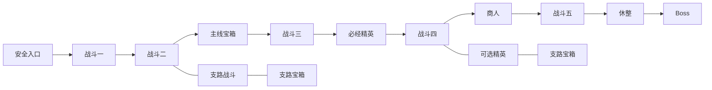

# Roguelike 随机关卡需求分析与技术选型

日期：2026-10-28。状态：用户已确认全部推荐基线，并授权开始增量开发。

目标项目：当前 Unreal Engine 5.8 的 test_25d。本文约定已批准的玩法、首版边界、生成规则、技术方向与验收方式；按可运行、可验证的增量推进。

推荐方向：以现有俯视角战斗为基础，制作一个可往返探索的单层地牢。每局先生成保证可通关的主路线，再增加少量可选支路；使用手工制作的房间模板，随机选择合规的组合、战斗配置和奖励。首版接入单人和双人 Listen Server 合作，由服务器决定布局及玩法状态。

以下房间数量、关卡形式、合作规则和首版范围均采用用户确认的推荐基线；明确标为调试值或性能初始目标的数值按实际验证调整，不作为已经达到的结果。这些参数不是参考游戏的实际参数。

## 1 玩家体验与成功标准

玩家进入地牢后，应当能够识别推进方向，也能选择额外探索。普通战斗消耗资源，宝箱提供收益，精英提供更高风险的挑战，商人与休整房提供调整机会，Boss 结束本层。改变 Seed 后，路线形状、房间组合与遭遇内容产生变化，同时仍保留稳定的难度节奏和必要服务。

首版希望验证四件事：

1. 随机布局能够稳定形成从入口到 Boss 的可通关路线。
2. 玩家通过不同功能房间感受到战斗、奖励、风险与恢复的节奏变化。
3. 房间确实具有可完成的玩法流程，而不只是摆放标志物或命名不同。
4. 同一局中的两名玩家看到相同布局、门状态、战斗结果和个人奖励记录。

不接受的结果包括：只有外观随机但每局路线相同；地图图论连通但实际门口无法通行；生成失败后无限重试；精英或 Boss 被支路绕过；怪物跨房间提前聚集；清房后不能开门；同一宝箱被重复领取；在编辑器中可用但打包后无法加载模板。

## 2 参考游戏与借鉴边界

| 参考 | 公开资料支持的特征 | 本项目借鉴 | 首版不引入 |
|---|---|---|---|
| Dead Cells | 原首席设计师介绍过固定宏观框架、手工房间块、概念图和出入口约束匹配的混合生成流程 | 先组织功能与节奏，再安排空间；让房间用途约束模板选择 | 多生物群系、移动能力解锁路线 |
| Enter the Gungeon | 官方商店介绍人工房间与程序迷宫结合，并包含商人、Boss 与探索 | 可行走的房间网络、分支探索、人工战斗空间 | 大规模隐藏内容和武器系统 |
| Hades | 官方历史更新记录涉及出口奖励预览、清理遭遇后开门、Boss 前商店 | 提前表达风险收益、战斗完成后推进、Boss 前补给 | 默认改成只能向前的逐房间关卡 |
| Slay the Spire | 官方介绍强调变化的路线布局以及危险或安全路线的选择 | 特殊房间的可读性、路线风险收益 | 将实时地牢直接改成点击节点选关 |

来源：[Dead Cells 原首席设计师文章](https://deepnight.net/tutorial/the-level-design-of-dead-cells-a-hybrid-approach/)、[Enter the Gungeon 官方商店](https://store.steampowered.com/app/311690/Enter_the_Gungeon/)、[Hades 官方 Big Bad 更新记录](https://www.supergiantgames.com/blog/hades-big-bad-update-patch-notes/)、[Hades 官方 Welcome to Hell 更新记录](https://www.supergiantgames.com/blog/hades-welcome-to-hell-update-patch-notes/)、[Slay the Spire 官方商店](https://store.steampowered.com/app/646570/Slay_the_Spire/)。这些材料用于参考公开机制；本文不推断商业游戏当前版本未公开的生成算法。

## 3 项目现状与复用边界

本节来自源码和既有制作记录的只读核查，不代表本次重新运行了相关地图或测试。

| 项目已有基础 | 可以复用的部分 | 此功能仍需要补足 |
|---|---|---|
| UE 5.8、俯视角玩家、GAS 与混合战斗 | 角色控制、技能、属性、伤害与反馈 | 关卡规则与战斗系统之间的连接 |
| L_DungeonLabyrinth 固定七房间 | Dungeon 网格与材质、房间尺度、走廊、地面碰撞校验思路 | 可重用房间模板、随机拓扑、门接口与运行时装配 |
| PureMass 普通怪物 | 实体生成、房间字段、移动、战斗、服务端复制 | 按房间激活、清怪计数、死亡原因通知、活动范围约束 |
| Actor 敌人 | ASC、现有 AI、生成点、死亡委托 | 精英和 Boss 的房间流程及最小遭遇配置 |
| LAN 组队和全员传送 | 建房、开始、全员 ServerTravel、进度交接 | 地牢生成及各端加载就绪屏障 |
| 背包与拾取 | 物品定义、库存、消耗品和服务端校验 | 宝箱结算、局内货币、商店交易规则 |
| 既有存档 | 玩家进度与已存在的可保存 Actor | 随机布局、动态对象、房间与奖励的稳定身份 |
| SOMOLMCP 与 Python 制作脚本 | 模板制作、编辑器检查、批量验证和报告 | 调用运行时生成核心的专用开发接口 |

重要约束：

- 现有 `layout.py` 写死七房间和走廊；它是编辑器制作工具，不是运行时随机生成器。
- `APureMassSpawnRegion` 默认在 BeginPlay 全量刷怪；将它直接放入随机模板会提前激活战斗。现有 PureMass 目标选择也没有完整房间边界限制。
- PureMass 有 `Room` 字段和实体 ID，但只有全局死亡计数，不能用它判断某房间清空。当前递增实体 ID 不能当跨局持久化身份。
- Actor 死亡委托涉及网络广播；房间结算必须仅由服务器执行并去重。
- 现有传送会从目标地图 PersistentLevel 预检查 PlayerStart。推荐新地牢宿主地图保留固定安全入口和出生点，再生成其余房间。
- `RoomLobby` 与 `RoomSubsystem` 表示在线大厅，不是空间房间。新设计使用 DungeonRoom 等名称以免混淆。
- 当前 LAN 默认两人，允许配置更多人数，开局后关闭新玩家加入；更多人数、断线重连不等于已完成验证。

核查入口：[工程配置](</C:/Users/greedy/Documents/Unreal Projects/test_25d/test_25d.uproject:3>)、[固定布局脚本](</C:/Users/greedy/Documents/Unreal Projects/test_25d/Scripts/Levels/DungeonLabyrinth/layout.py:20>)、[地牢制作说明](</C:/Users/greedy/Documents/Unreal Projects/test_25d/Scripts/Levels/DungeonLabyrinth/README.md:5>)、[PureMass 生成与默认生成区域](</C:/Users/greedy/Documents/Unreal Projects/test_25d/Source/test_25d/Private/PureMass/PureMassGameMode.cpp:25>)、[实体生成与死亡](</C:/Users/greedy/Documents/Unreal Projects/test_25d/Source/test_25d/Private/PureMass/PureMassSubsystem.cpp:90>)、[现有功能清单](</C:/Users/greedy/Documents/Unreal Projects/test_25d/docs/project-feature-catalog.md>)。

## 4 三种关卡形式与建议选择

| 形式 | 玩家体验 | 实现与内容成本 | 与本需求的关系 |
|---|---|---|---|
| A 连续地牢 主线加支路 | 直接走过门和走廊，可返回已清理区域，探索支路 | 需要空间拼接、实际连通验证、房间边界和合作门控 | 推荐；最符合当前地牢素材和实时探索 |
| B 逐房间推进 | 战后选门进入下一房间，通常不回头 | 可减少同时加载量，但需要房间切换、队伍过门和选择规则 | 若更看重快节奏战斗，可以替代 A |
| C 节点选路 | 在地图选择战斗、商人等节点，再进入独立场景 | 空间拼接压力小，新增选路界面及场景切换流程 | 若更看重路线规划，可以替代 A |

推荐选择 A。本文后续具体规则以 A 为基线。主脉络定义为一条必须经过的入口到 Boss 路线；支路是可不进入的额外内容。首版不引入多条主线汇合、闭环捷径或钥匙门，因此能够清楚保证必经节点。

空间装配也存在三种取舍：固定地图随机内容最快，但路线变化不足；房间模板拼接能同时控制战斗空间和路线变化，建议采用；完全随机生成地形和房间内部结构的验证与美术成本更高，留作后续扩展。

## 5 首版范围与生成参数

范围为一个地牢主题、一个可完整结束的楼层。布局在进入本层时生成一次，运行中不重新洗牌；首版在安全入口等待期间装配本层全部房间，暂不做随玩家移动的房间卸载。

| 参数 | 建议默认值 | 说明 |
|---|---|---|
| 主路线房间数 | 10 至 12 | 含入口、宝箱、精英、商人、休整和 Boss |
| 支路房间总数 | 4 至 6 | 分到 2 至 3 条支路，每条 1 至 3 房间 |
| 全层房间总数 | 14 至 18 | 走廊和出口传送点不单独计房间 |
| 普通战斗主线房 | 4 至 6 | 加六个固定功能房后恰为 10 至 12 |
| 精英房 | 主线 1，支路 0 至 1 | 主线精英必经；支路精英是可选风险 |
| 宝箱房 | 全层 2 至 3 | 主线 1，支路至少 1 |
| 商人房 | 主线恰好 1 | 精英之后、Boss 前的休整房之前 |
| 休整房 | 恰好 1 | 紧邻 Boss 的前一房 |
| Boss 房 | 恰好 1 | 主线末端；击败后生成结算出口 |
| 随机事件房 | 首版关闭 | 保留类型接口，后续加入 |
| 合作人数 | 单人及双人 | 复用 Listen Server；独立专用服务器和更多人数另行验证 |
| 单层游玩时长 | 暂定 15 至 25 分钟 | 需结合实际战斗和回溯时间调整 |

最小内容库建议为 11 个房间模板：入口 1、普通战斗 4、宝箱 1、精英 1、商人 1、休整 1、Boss 1、可兼作支路的战斗模板 1。可通过少量合法旋转和内容配置复用，生成前检查端口适配能力。模板数量只是内容起点，不能保证所有图都能拼接成功。

建议以单层、平面连通为初始限制。已有地牢台阶可以作为房内装饰或已验证的小高差；首版不随机生成跨层连接、跳跃路线或能力门。

## 6 房间职责与完成条件

| 房间 | 进入后的行为 | 完成条件与输出 | 边界 |
|---|---|---|---|
| 安全入口 | 展示生成状态，等待全队加载，允许调整技能 | 全部就绪后打开入口 | 不刷怪，不发可重复领取奖励 |
| 普通战斗 | 集结后关门，按预算生成一组或多波普通怪 | 本遭遇要求的敌人全部解决后开门，发一次清房收益 | 普通怪走 PureMass；未激活房不预刷怪 |
| 宝箱 | 安全交互并展示奖励 | 每位玩家可获得一次个人奖励 | 重复请求、同时交互不能重复发放；背包满时保留待领取 |
| 精英 | 生成一名 Actor 精英及可选少量普通怪 | 本遭遇全部必要目标解决 | 奖励高于普通房；首版使用已有技能组合做可区分原型 |
| 商人 | 展示三项商品，显示价格和余额 | 购买可选，任何玩家均可继续前进 | 个人局内货币、个人库存；服务端原子扣款及发货 |
| 休整 | 每位玩家领取一次恢复机会并整理技能 | 无须消耗恢复也可离开 | 初始建议恢复最大生命 30%、法力 30%，不超过上限 |
| Boss | 全队集结后关闭入口并激活一名 Actor Boss | Boss 及明确标记为必杀的召唤物完成后结算 | Boss 死亡后停止追加怪物；非必杀召唤物回收，避免永久锁门 |

商人、精英和 Boss 的功能闭环属于首版范围。美术可以复用，精英/Boss 必须至少有可辨认的攻击配置、血量显示和结束事件；复杂阶段机制、新骨骼或新动画不作为生成器首版前置。

货币暂定为仅本局有效的个人余额，由清房收益提供；商人库存为每人三项、每项限购一次，不刷新。价格与收益表应确保玩家只走主线且未提前消费时，到商人至少能购买最便宜的一项商品。现有持久化角色与背包保持原有策略；新局内货币不写入旧角色金币字段，也不借用技能点。跨局道具收益和成长另见待确认项。

玩家死亡的建议首版规则为：阵亡玩家本房观战；存活队友清房后，服务器在安全点将其恢复到配置生命比例；全队阵亡结束本局，不自动沿用旧检查点重开当前房。该规则需要与既有角色重生流程适配，属于新增工作。

## 7 随机规则与主脉络约束

### 7.1 固定项与随机项

| 必须由规则保证 | 可以在规则内随机 |
|---|---|
| 入口、主线精英、商人、休整、Boss 的数量和顺序 | 合法范围内的主线长度及功能房深度 |
| 入口到 Boss 的完整路线 | 路线折转、支路挂接位置及长度 |
| 真实可行走、无重叠、无越界 | 房间模板与允许的朝向 |
| 战斗和补给的基本节奏 | 敌人组合、波次、符合预算的数量 |
| 奖励只结算一次、商品可负担性底线 | 宝箱内容、商品组合、可选精英奖励 |
| 玩家和敌人出生安全 | 通过地面及导航检测的出生标记选择 |

### 7.2 主线规则

1. 入口后的前两个房间为普通战斗，不生成精英、商人或 Boss。
2. 主线精英出现前，必须已经经过至少三个普通战斗房。
3. 主线宝箱位于入口之后、精英之前；商人位于精英之后、休整之前；休整紧邻 Boss。
4. 主线上连续战斗房不超过三个；精英计入战斗房，最终 Boss 由休整隔开。
5. 主线相邻战斗房避免使用同一几何模板。候选不足时可放宽这种多样性偏好，但不放宽连通、房间配额或任务顺序。
6. 支路在精英或 Boss 等必经节点的两侧不能形成绕行。首版仅允许树状支路，不生成闭环。

示例是一局合法结果，不代表固定顺序长度：

该示例为 11 个主线房加 4 个支路房，共 15 房。连线表示连接关系，不表示地图中的实际位置；清理后允许沿原路返回。

### 7.3 支路规则

支路入口最多深入三个房间。每条支路末端必须有明确额外收益，可由宝箱或精英清房奖励提供；不能只有没有收益的长死路。生成时先给每条支路分配奖励终点，再抽取中间内容，保证“支路末端宝箱数 + 独立作为末端的精英房数 ≥ 支路数”。精英后再接宝箱只满足同一条支路；不把它计为两个奖励终点。因此三条支路需要两个末端宝箱和一个末端精英；不满足配额的组合不得进入空间装配。

首版提供简易的已探索房间图和相邻门口类型提示，显示当前位置、已清理状态及可见的风险/奖励类型；全队共享探索进度，不显示未探索区域的几何或全层预知路线。精确实时小地图、全屏美术地图、自动寻路和地图点击传送不在首版范围。此 UI 范围已随第 13 节推荐基线确认。

支路预算不得挤占主线的必需宝箱、商人或休整配额。普通支路可以在玩家想快速通关时全部跳过。支路遭遇也遵守连续战斗不超过三个的限制，按从挂接点进入支路的一次探索方向计算，不重复计已清理主线房。

### 7.4 遭遇与奖励预算

按主线深度分前、中、后三段，每段给出战斗预算和允许怪物池。普通怪数量、远程比例、波次数量及同屏上限分别约束，避免只增加血量和数量。初始调试可采用每普通房 8 至 16 个实体、同时活动普通怪上限 30；这些数值须经玩法测试调整。

不以现有“全图 200 Goblin”测试配置作为每局默认生成方式。首版全局同时最多激活一个战斗遭遇。精英和 Boss 的强度分别配置，不从普通怪总数简单换算。

奖励随机流与布局、战斗、装饰随机流分离；增加装饰或修改战斗特效不应改变宝箱内容。奖励与购买使用明确的结算身份，防止重入或网络重试重复发放。

## 8 房间流程与合作规则

战斗房状态建议为：未发现 → 已发现未进入 → 等待队伍集结 → 战斗中 → 已清理。开箱、领取休整、商品购买属于各自的交互记录，不用“房间已清理”统一代替。

第一名玩家进入未清理战斗房的入口区域时，显示集结状态；入口仍可退出，通向更深房间的出口保持关闭。所有当前连接且存活的队员进入安全区域、场景及导航就绪后，服务器才关门和刷怪。有人撤回则取消集结。首版没有超时强制拉人，避免无提示传送。已阵亡观战玩家不计入集结条件。

战斗中，玩家与怪物不能从关闭的门离开；位移技能、投射物和刷怪也遵守房间边界。怪物只选择本次遭遇中的合法玩家目标，不因全局最近玩家而越房追击。清房后允许自由回访已清理区域，但不刷新敌人或重复结算。

服务器维护本遭遇的待生成波次和存活目标集合，不能只数场景中还剩几个 Actor。Actor 敌人和 Mass 实体都登记到同一遭遇账本；召唤、死亡、回收、异常销毁使用不同原因。正常清房要求没有待生成波次、没有必杀存活目标。异常销毁不默认等于击杀成功，而是进入恢复处理。

合作范围建议先保持现有开局后禁止新玩家加入的策略。玩家中途断开后移出集结名单；剩余玩家可以继续。房主退出结束会话，首版不做主机迁移。参与者减少时不重新发放奖励、不立即重置当前战斗血量，下一遭遇再按人数预算。游戏中的两名玩家须共享同一个布局版本和房间状态。

网络门控以服务器决定为准。未准备好的客户端停留在安全入口；客户端不能通过提交 Seed、房间完成事件或奖励领取数量决定服务器结果。初始加载建议提供可见进度及 30 秒超时提示，可返回大厅重试，不能无限黑屏等待。

## 9 技术选型与职责划分

### 9.1 总体技术方向

推荐采用“带约束的房间关系图 + 网格占位与门接口匹配 + 手工房间模板 + 房间状态机”。先解决功能与顺序，再解决几何位置，最后装配世界、生成导航并启用玩法。

| 技术 | 用途 | 首版定位 |
|---|---|---|
| C++ 运行时模块 | 生成、校验、随机流、状态管理、服务端规则 | 必需；核心逻辑应可脱离渲染运行验证 |
| Blueprint 与 DataAsset | 房间美术、交互表现、模板与遭遇参数 | 必需；策划配置不必修改生成算法 |
| 房间图与 BFS/DFS | 主支路组织、可达性、深度和必经节点检查 | 必需 |
| 网格占位、门接口、有限回溯 | 在空间放置模板、避免重叠、连接走廊 | 必需 |
| FRandomStream 与独立子种子 | 可重现布局及分离随机用途 | 必需；稳定候选排序和生成版本同样需要记录 |
| 子关卡模板与动态关卡实例 | 加载人工制作的房间集合 | 推荐；先验证旋转、重复实例、碰撞、导航和打包 |
| Recast NavMesh 动态生成 | 为运行时新增地板建立可走区域 | 必需；碰撞和导航就绪后才能放行 |
| GameMode 与复制状态 Actor/GameState | 服务端组织生成，向客户端传递结果和房间状态 | 必需；客户端不得依赖仅服务端存在的 GameMode |
| Automation Tests 与功能测试 | 批量 Seed、图约束、实际路径、多人场景 | 必需 |
| Unreal Insights 与结构化日志 | 定位生成、装配、导航、复制开销和失败 | 建议纳入首版调试 |
| PCG Framework | 模板中的碎石、植物、非阻挡装饰变体 | 可选；首版拓扑和通关规则不依赖它 |

Epic 提供可重复的 [Random Streams](https://dev.epicgames.com/documentation/en-us/unreal-engine/random-streams-in-unreal-engine)，但同一个 Seed 只有在输入数据、候选顺序和随机调用规则一致时，才足以复现本项目的生成结果。项目建议记录 Seed、生成算法版本、配置版本、模板集合版本和最终布局摘要。

### 9.2 模板与空间装配

每个模板至少描述：模板 ID、用途标签、占地范围、高度、允许旋转、门接口的位置与朝向、入口安全区、怪物生成点、奖励点，以及不能被装饰占用的通行区域。

优先复用现有 400 cm 网格基准和地牢资产，房间可占多个网格。门宽、净高、玩家胶囊和最大敌人体型形成统一通行规范；现有 800 cm 主通道可作为初始参考，最终由通行测试决定。门接口必须双向匹配，走廊同样参加占位检测；不使用任意缩放或镜像来勉强接门。

推荐把每个房间的静态环境制作成子关卡模板，再由运行时按照布局清单加载。战斗、奖励和交易等有权威状态的对象由服务端玩法管理器生成或激活；客户端装配环境时不能额外创建另一套有效敌人或奖励。

UE 的 [Level Instancing](https://dev.epicgames.com/documentation/en-us/unreal-engine/level-instancing-in-unreal-engine) 适合重复使用手工组合内容；运行时可评估 [LoadLevelInstanceBySoftObjectPtr](https://dev.epicgames.com/documentation/en-us/unreal-engine/API/Runtime/Engine/ULevelStreamingDynamic/LoadLevelInstanceBySoftObjectPtr)。编辑器可放置的 Level Instance 不代表自动具有本项目所需的网络加载、生命周期和卸载策略。模板软引用必须进入 Cook 依赖；实例名称由稳定 RoomId 派生。

首轮技术验证若发现动态子关卡导航或打包不满足要求，可改用 Blueprint 房间容器承载静态组件；逻辑图、模板元数据与遭遇规则保持相同。这是实现载体的备选，不改变推荐玩法。

### 9.3 为什么不把 PCG 或 WFC 作为首版核心

UE 的 [PCG Framework](https://dev.epicgames.com/documentation/en-us/unreal-engine/procedural-content-generation-framework-in-unreal-engine) 是程序化内容工具集，可以扩展到复杂世界内容。本项目仍需自己定义主线、房间配额、预算、网络权威与清房条件；建议第一版仅在需要时用它生成不影响通行的装饰。

本项目更适合先直接表达房间图和全局规则。BSP 空间切分、随机游走、WFC 等可作为后续局部空间或装饰的候选方法；首版没有必要同时引入多种算法。即使以后采用局部相邻约束，也仍保留 Boss 可达与关键房间顺序等整体校验。

### 9.4 导航与网络

运行时拼接增加新的地板时，需评估 Dynamic NavMesh；Dynamic Modifiers Only 只能改变已有导航区域，不能创建新的导航表面。[Epic 导航模式说明](https://dev.epicgames.com/documentation/en-us/unreal-engine/overview-of-how-to-modify-the-navigation-mesh-in-unreal-engine)

先装配整层碰撞，再等待导航构建；通过入口、门两侧、房间安全点和敌人出生点的路径检查后才进入就绪状态。生成阶段在所有合法通路门开放的检查状态下验证入口到 Boss 及各支路，完成后恢复初始玩法门状态，再放行玩家。运行期分别验证当前允许进入的区域和关门阻挡，不能把任务门暂时关闭误判成地图生成失败。布局图连通和导航可达是两项独立验收。当前鼠标寻路也可能依赖客户端导航，因此服务器与客户端都要验证对应的移动方式；不能只验证服务器怪物移动。

网络采用 UE 的[服务器权威模型](https://dev.epicgames.com/documentation/en-us/unreal-engine/actor-owner-and-owning-connection-in-unreal-engine)。服务器产生最终布局清单，包括 RoomId、模板 ID、位置、朝向、连接关系与版本；客户端按清单装配并回报就绪。Seed 主要用于复现，不作为唯一同步内容。门、遭遇、奖励和商店状态通过明确的状态复制维护，不能仅依赖一次性广播事件。

### 9.5 需要的数据

| 数据 | 核心内容 |
|---|---|
| 楼层生成配置 | 房间范围、功能配额、节奏规则、模板池、失败预算 |
| 房间模板定义 | 几何边界、用途、门接口、朝向、生成点、资产引用 |
| 遭遇与奖励配置 | 怪物池、波次、难度预算、奖励表、商人价格 |
| 运行布局清单 | RunId、Seed、版本、RoomId、模板及变换、连接、布局摘要 |
| 房间运行状态 | 已探索、集结、波次、存活目标集合、完成结果、个人交互记录 |

随机地牢对象使用稳定 RoomId、EncounterId 和 RewardId；Mass 当前实体 ID 只作运行时映射。相同 Seed 用于新的 RunId 时，布局可相同，但领取状态属于新一局，不能互相污染。可复现性比较使用规范化布局：模板、变换、连接、生成参数及相关版本按稳定顺序序列化；排除 RunId、时间戳、加载耗时和日志字段。

## 10 生成流程与失败处理

1. 校验配置及模板资产，检查必要用途与门接口是否齐全。
2. 根据 Seed 和版本建立独立随机流，生成主线功能顺序与支路。
3. 为房间选择模板、朝向和坐标，预留走廊及门空间；候选失败时有限回溯。
4. 检查图连通、必经顺序、房间配额、空间占位与通行净空，输出最终布局清单。
5. 服务器与客户端装配世界；碰撞及导航就绪后验证实际路径。
6. 全队准备完成，开放安全入口；未进入的战斗房保持不刷怪。
7. 按房间流程激活战斗、发放收益、处理商店；Boss 完成后生成返回出口并结束本局。

禁止无界重试。建议初值为每次空间方案最多 2000 次候选尝试、最多 8 次布局重建；候选顺序、次数预算和重建规则保持确定性。回退顺序为：更换模板或朝向、调整支路布局、重新生成本次尝试、使用预验证备用布局。所有尝试由输入 Seed 和尝试编号推导，失败记录能够复现。额外的墙钟时间上限仅触发明确的超时失败或取消，不因机器速度不同而悄悄选择另一份成功布局。

备用布局仍满足主线、功能房、通行和玩法要求；运行时仍需加载及导航检查。资源缺失或导航失败使备用布局也不可用时，保留玩家在安全区，展示失败原因并允许返回大厅。不能发布断路地图，也不能默默删掉必需房间。

## 11 调试 自动化与保存范围

开发者需要能看到逻辑图与实际布局的对应关系：房间 ID、用途、主支路归属、深度、门接口、碰撞占位、导航路径、遭遇状态和剩余目标。错误需要指出具体对象和阶段，例如“房间 R07 的东门没有匹配接口”，而不只输出“生成失败”。

建议提供以下开发接口，名称仅作设计示意，均尚未实现：

| 能力 | 输入与输出 | 约束 |
|---|---|---|
| 预览布局 | 配置与 Seed → 房间图、模板分配、校验结果 | 不修改当前游戏世界 |
| 生成测试关卡 | 预览结果 → 测试世界与生成报告 | 仅开发环境，明确目标世界 |
| 验证布局 | 布局清单 → 配额、连通、门匹配、导航错误 | 返回结构化错误和具体 RoomId |
| 查询运行状态 | RunId/RoomId → 状态、目标集合、门与奖励记录 | 只读；区分服务端与客户端 |
| 批量测试 Seed | 范围或固定清单 → 成功率、回退率、耗时及失败清单 | 无渲染图测试与真实世界测试分开统计 |

MCP 是这些能力的开发入口，调用同一套运行时核心，而不是维护第二套生成逻辑。世界写入遵守现有独占锁，不让多个智能体同时修改同一个编辑器世界。现有 SOMOLMCP 为 Editor 插件；UE Python 用于编辑器自动化，不能作为打包游戏的运行时生成依赖。[Epic Python 使用范围](https://dev.epicgames.com/documentation/en-us/unreal-engine/scripting-the-unreal-editor-using-python)

每次失败报告保留 Seed、算法/配置/模板版本、布局清单、失败阶段、RoomId、原因、耗时、回退次数和服务器/客户端日志关联 ID。禁止把新生成地图覆盖到现有 L_DungeonLabyrinth；原地图作为素材和回归样例保留。

保存范围建议：首版支持当前进程内完整局状态、可导出布局复现文件，以及沿用现有玩家进度交接；暂不支持退出游戏后继续同一随机局，也不支持断线重连恢复。现有按地图和 Actor 名称匹配的存档不能直接承担这些功能。后续若加入续局，必须保存最终布局及房间、波次、领取、交易、货币等状态，而不能只保存 Seed。

现有依据：[组队传送及静态出生点检查](</C:/Users/greedy/Documents/Unreal Projects/test_25d/Source/test_25d/Private/Game/MyGameModeBase.cpp:507>)、[世界保存与恢复](</C:/Users/greedy/Documents/Unreal Projects/test_25d/Source/test_25d/Private/Game/MyGameModeBase.cpp:322>)、[在线会话定义](</C:/Users/greedy/Documents/Unreal Projects/test_25d/Source/test_25d/Public/Online/RoomSubsystem.h:44>)。

## 12 验收标准与后续阶段

以下为建议验收基线。功能条件为硬性条件；性能数值为待参考机器和打包配置确认后冻结的初始目标，不是已测结果。

| 编号 | 验收内容 | 通过条件 |
|---|---|---|
| A01 | 逻辑生成 | 固定 1000 个 Seed 全部输出合法布局或明确失败；绝不将不合法布局标记为成功 |
| A02 | 正常生成质量 | 完整合规模板库下，上述 Seed 最终都可进入游戏；备用布局使用率目标不超过 1%，不能靠同一备用图伪装随机 |
| A03 | 可复现性 | 相同 Seed、相关版本和配置重复 10 次，排除 RunId 等运行字段后的规范化布局及摘要相同；仅更换装饰配置不改变逻辑布局和奖励 |
| A04 | 多样性 | 统计房间类型顺序、带模板的连接图和空间布局三类摘要，至少两类中存在显著变化；固定 100 Seed 的完整布局唯一率目标不低于 90% |
| A05 | 真实通行 | 至少 20 个固定 Seed 实例化后，在合法通路门开放的检查状态下验证入口到 Boss、各门、支路及出生点；恢复玩法门状态后，单独验证关闭门不能穿越 |
| A06 | 房间玩法 | 每类房至少验证一次完整进入、交互/战斗、完成和回访；无重复收益或重刷 |
| A07 | 混合敌人 | Actor 与 Mass 混合遭遇及召唤场景计数准确；重复死亡通知、异常回收不会误结算或永远锁门 |
| A08 | 联机一致 | Listen Server 房主加一名客户端，至少 10 个固定 Seed，布局和房间状态一致，双方都能完成移动、战斗及交互 |
| A09 | 合作边界 | 队员门外等待、战斗阵亡、全队阵亡、玩家掉线、房主退出与慢客户端均按规则处理 |
| A10 | 交易与奖励 | 同时开箱、重复请求、余额不足、背包满都不重复发货或错误扣款；主线收益可负担最低价商品 |
| A11 | 失败恢复 | 注入缺模板、端口不匹配、导航失败和客户端超时，得到有界回退或可返回大厅的明确错误 |
| A12 | 打包验证 | Windows Development 打包版本可加载全部房间模板，完成至少一局单人和一局双人；不依赖编辑器 Python/MCP |
| A13 | 生成性能 | 参考机上纯布局计算 P95 初始目标 100 ms；预热资源后整层装配与导航就绪 P95 初始目标 10 秒，分别测量并记录 |
| A14 | 资源清理 | 连续开始/结束 10 局，无上一局房间、实体、计时器、奖励记录残留；保留现有回归场景可用 |
| A15 | 探索提示 | 双人共享已探索房间、当前所在位置和清理状态；相邻门提示类型，未探索几何不泄露；不把开发调试图代替玩家界面 |

生成时间、导航时间与战斗帧耗时分别测量；客户端端到端就绪时间另计网络与加载。原 200 Goblin 的编辑器采样不作为新地牢或打包版性能指标。画面质量、战斗手感和探索节奏还需要人工试玩，不能仅用图校验代替。

批准后的工作可按可验证结果划分为四个阶段，具体任务和实现计划届时再制定：

1. 技术验证：三个房间拼接，双端加载、门口碰撞、导航、Cook 依赖和固定入口放行。
2. 地图生成：完整主支路、模板选择、有限回溯、备用布局、批量 Seed 与可视化检查。
3. 玩法接入：按房间生成 Actor/Mass、门控、清房奖励、宝箱、最小商人、精英和 Boss 原型。
4. 完整验收：双人状态同步、死亡与掉线、失败恢复、打包版本及性能记录。

如果第一阶段证明连续地牢的模板装配成本超出预期，先回到方案选择，明确是否改为 Blueprint 容器或逐房间推进，不能未经确认直接更改玩家体验。

## 13 已确认的决策

| 决策 | 推荐基线 | 不同选择的影响 |
|---|---|---|
| 关卡形式 | A 连续可回访地牢 | B 逐房推进或 C 节点选路会改变空间生成、界面与合作流程 |
| 主脉络含义 | 唯一必经主线，附可跳过支路 | 多条主线汇合需要重新定义必经精英和补给保证 |
| 随机程度 | 手工房间模板，随机组合与内容 | 固定地图更快；房内几何全随机显著增加验证与内容成本 |
| 首版规模 | 单主题单层，主线 10 至 12、总计 14 至 18 房 | 更短适合快速验证；多层会新增跨层状态与内容工作 |
| 合作方式 | 单人及双人，全队集结后开战 | 允许分头开房需要同时多遭遇、奖励归属与额外性能设计 |
| 内容完成度 | 最小可用宝箱、个人商店、精英与 Boss 原型 | 仅标记功能房可先验证生成，但不能算完整玩法验收 |
| 玩家地图提示 | 简易已探索房间图及相邻门类型提示 | 只做门口提示可缩减 UI；精确实时小地图需要另加定位及绘制范围 |
| 进度与死亡 | 局内货币重置，清房复活，全灭结束；现有角色成长沿用 | 纯 Roguelike 全部成长重置、永久掉落结算或检查点重试都需另定 |
| 续局与网络范围 | 首版无跨进程续局、断线重连、主机迁移 | 如首版需要，应提前加入稳定快照与恢复设计 |

用户于 2026-10-28 确认本表全部推荐基线并授权增量开发。首个增量验证三房间装配、固定入口、导航与双人就绪；后续按第 12 节顺序扩展完整生成和房间玩法。
